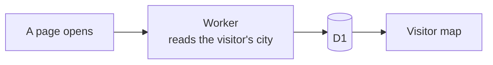
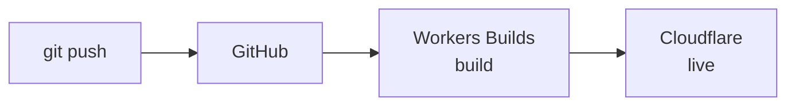

My old homepage was a Jekyll academic template on GitHub Pages. It worked, but every time I wanted to add something of my own, I first had to read a template someone else had written.

So this time I tore it down and started again. The new site has no server, yet a cat lives in it that can chat, there is a globe you can drag around, and at the very bottom of the page there is a map of visitors. The whole thing was done together with Claude Code: I said what I wanted and chose between options, and it wrote the code and ran the checks.

This post takes the site apart: what it uses, why I chose it, and where I fell into a trap.

## The whole picture first


In the end there are only three things: a pile of static files, two API addresses, and two storage buckets.

The body of the site is purely static. The build produces a set of HTML, CSS and JS files, and those files are what a visitor receives; no program runs in between. Only two addresses, both under `/api/`, execute any code, and they keep the visitor log. Large files such as photos and model weights sit in storage buckets of their own, and the pages only point to them.

## Why Astro

A personal homepage has one defining trait: nine tenths of it is text that does not move. A bio, a list of papers, blog posts. Once written, they are done.

Many front-end frameworks, by default, hand the whole page to JavaScript and render it a second time in the visitor's browser. For a site that is mostly text, that makes visitors pay in bandwidth for something they never use. Jekyll is purely static, but adding a little interaction inside its templates is awkward.

[Astro](https://astro.build) stands right in the middle. By default it outputs plain HTML with not one line of JavaScript; only the parts that need interaction load a script, each its own. There is no React on this site, and no Vue. The globe's code loads only on the Misc page, and the visitor map's code is not fetched until you have nearly scrolled to the bottom. The diagrams you are looking at work the same way: the Mermaid library that draws them is not small, and only posts with a diagram load it.

The other thing I like is how content is managed. Papers and blog posts are Markdown files, and each kind has an agreed set of fields:

```ts
const blog = defineCollection({
  loader: glob({ pattern: '**/*.{md,mdx}', base: './src/content/blog' }),
  schema: z.object({
    title: z.string(),
    date: z.coerce.date(),
    lang: z.enum(['en', 'zh']).default('en'),
    tags: z.array(z.string()).default([]),
    draft: z.boolean().default(false),
  }),
});
```

A malformed date or a missing title makes the build fail on the spot, so a broken page never goes live. Adding a paper means adding one file; the selection on the homepage, the list on the publications page and the cat's knowledge all follow.

## Colour: taken from a painting


The colours do not come from a ready-made palette. They were taken from Monet's *Impression, Sunrise*. The teal of the harbour's morning mist is the main colour, the small orange of the sun is the second accent, and the background is a warm off-white, like unpainted canvas.

<div class="swatches">
<span style="--c:#f5f5f0"><b>Canvas</b><code>#f5f5f0</code></span>
<span style="--c:#fbfbf8"><b>Paper</b><code>#fbfbf8</code></span>
<span style="--c:#1b2a2a"><b>Ink</b><code>#1b2a2a</code></span>
<span style="--c:#5d6b6a"><b>Grey-green</b><code>#5d6b6a</code></span>
<span style="--c:#dce2df"><b>Hairline</b><code>#dce2df</code></span>
<span style="--c:#2f6260"><b>Harbour teal</b><code>#2f6260</code></span>
<span style="--c:#dbe8e6"><b>Pale teal</b><code>#dbe8e6</code></span>
<span style="--c:#b9552c"><b>Sunrise orange</b><code>#b9552c</code></span>
</div>

The orange is used sparingly. It appears in only a few places: the emphasised words of the homepage headline, the side branches and advisors' names in the career section, the answer the cat is generating, and the dots on the visitor map. A colour that is everywhere is no longer an accent.

The dark theme is not the light one inverted. It is the same painting at night:

<div class="swatches">
<span style="--c:#0e1717"><b>Night</b><code>#0e1717</code></span>
<span style="--c:#142121"><b>Surface</b><code>#142121</code></span>
<span style="--c:#e4eae8"><b>Text</b><code>#e4eae8</code></span>
<span style="--c:#93a3a2"><b>Grey-green</b><code>#93a3a2</code></span>
<span style="--c:#253433"><b>Hairline</b><code>#253433</code></span>
<span style="--c:#7fc3bd"><b>Harbour teal</b><code>#7fc3bd</code></span>
<span style="--c:#183635"><b>Deep teal</b><code>#183635</code></span>
<span style="--c:#f0926c"><b>Sunrise orange</b><code>#f0926c</code></span>
</div>

There are five paler colours as well, used only to tint tokens in the homepage headline's generation animation. Their names also come from things in Monet's paintings:

<div class="swatches">
<span style="--c:#f3d4dc"><b>Lily pink</b><code>#f3d4dc</code></span>
<span style="--c:#f1e7b8"><b>Sunlight yellow</b><code>#f1e7b8</code></span>
<span style="--c:#cfe7d2"><b>Leaf green</b><code>#cfe7d2</code></span>
<span style="--c:#cfe0ef"><b>Water blue</b><code>#cfe0ef</code></span>
<span style="--c:#ddd6ef"><b>Wisteria</b><code>#ddd6ef</code></span>
</div>

The implementation is plain: each colour is a CSS variable, the dark theme simply gives the same variable names another set of values, and components only ever write `var(--accent)`. At the top of each page there is also a Monet that fades into the background: *Impression, Sunrise* on the publications page, *Water Lilies* on the blog, *Woman with a Parasol* on the photos page, and the Japanese footbridge on Misc.

## Typefaces

<div class="specimen">
<p style="font-family:var(--serif);font-size:1.7rem"><small>Newsreader · headings and long English text</small>Building code agents for <em>the real world.</em></p>
<p style="font-family:var(--sans);font-size:1.05rem"><small>Inter + the system's Chinese typeface · interface and Chinese text</small>Research Engineer，正在做基于大模型的代码智能体。</p>
<p style="font-family:var(--mono);font-size:0.9rem"><small>The system's monospace · code, dates and numbers</small>$ git log --graph career　　scholar.open()　　Sep 2026</p>
</div>

There are three roles.

**Headings and long English text use [Newsreader](https://fonts.google.com/specimen/Newsreader)**, a serif designed for long reading on screens. It is a variable font with an "optical size" axis: at large sizes the strokes have more contrast and finer detail, and at small sizes it is sturdier and easier to make out. One font file, and headlines and body text each get their own cut.

**The interface and Chinese text use [Inter](https://rsms.me/inter/)**, together with the Chinese typeface already on the visitor's system. I do not make visitors download a Chinese font: one easily runs to several megabytes, while PingFang, Microsoft YaHei and Noto Sans are already on everyone's device.

**Code, dates and numbers use the system's monospace**, which also needs no download.

Newsreader and Inter are hosted with the site itself and do not go through Google Fonts. The three most used font files are preloaded at the top of the page, to keep text from appearing in another typeface first and then jumping to the final one.

Chinese and English posts are also set differently. English uses the serif at a line height of 1.7; Chinese switches to the sans-serif, with the line height opened to 1.9, justified, and punctuation kept from starting a line:

```css
.prose:lang(zh) {
  font-family: var(--sans);
  line-height: 1.9;
  text-align: justify;
  line-break: strict;
}
```

A fourth typeface hides on the Misc page: the achievements board uses the pixel font Pixelify Sans, only 12 KB, loaded only on that page. The level number on the board is the exception and uses the monospace, because in the pixel font a 5 looks too much like an S.

## A few small touches on the homepage

**The headline is "generated".** The homepage headline appears token by token, the way a language model decodes: what has not been generated yet is noise of the same shape, and a small chart beside it draws a "next-token distribution", from which one bar is sampled at each step. The real text is in the HTML all along and the noise is only laid over it, so search engines can read it, people who turn animations off still see it, and the layout never shifts.

**Links are written as tool calls.** The Google Scholar and GitHub links on the homepage read `scholar.open()` and `github.pull()`. People who build agents will probably smile.

**The career section is drawn as `git log --graph`.** The main line is a commit history, an internship is a branch pulled off to the side, and when it ends it merges back.

## The cat in the corner

Pop Cat, in the bottom-right corner, is a real language model: Qwen3.5 0.8B, running in your own browser through [WebLLM](https://webllm.mlc.ai), on your graphics card (WebGPU). There is no inference server behind it and no API key.

A few details here are worth telling.

**The weights download only when you ask your first question.** About 430 MB, and then they stay in the browser's cache. The model runs in a background thread, so the page does not freeze while it thinks.

**The weights are in my own R2 bucket.** The default download address is Hugging Face, which cannot be reached from mainland China. R2 has another advantage: download traffic is free, which matters for a 430 MB file.

**What the cat knows is not written by hand.** At build time a script puts the site's career, papers and achievements together into a profile and hands it over. When I edit my career, the cat changes its story too.

**Small models do not quite do as they are told.** I wanted every sentence to end in "meow", and a 0.8B model cannot keep that up consistently. The fix is blunt: do not count on it; wait until it has finished, and let code change every sentence to end in "meow". For the same reason, when a question is in Chinese, the instruction to answer in Chinese is said both before and after the question, because a small model tends to answer in the language it read first and last.

## The globe

The Misc page has a globe marking the places I have been.

The first version used a dot-matrix style library that draws coastlines as small dots. It looks cool from a distance and turns to mush when you zoom in. I then switched to drawing it myself on a canvas: [d3-geo](https://d3js.org/d3-geo) for the orthographic projection, and [Natural Earth](https://www.naturalearthdata.com) vector data for coastlines and borders. Vector data stays sharp at any zoom, and the whole world map is only about a hundred KB.

The place names have to keep out of each other's way. The rule is simple: a name is written to the right of its dot; if the right is taken, it goes on the left; if neither side has room, only the dot is drawn, and the name appears once you zoom in.

Two interesting problems came up during the rewrite.

The first: for a while, the globe was a plain disc with no land. The script reads its colours from CSS variables, and the page still had the old version's variable names; the new ones were simply not defined. Giving a canvas an empty colour value raises no error. It quietly keeps the previous colour, so land, sea and lines all came out the same.

The second: after zooming in four times and out four times, the "zoom out" button did not turn grey. Each step multiplies or divides by 1.6, and after the round trip a floating-point number is not exactly 1 but a tiny bit more.

## The visitor map and the log

The visitor map at the bottom of the homepage is the only place where this site uses a "back end".



The back end is a [Cloudflare Worker](https://developers.cloudflare.com/workers/) of about two hundred lines, plus a D1 database (SQLite running on Cloudflare). Each page reports to `/api/log` once when it opens, with `sendBeacon`; Cloudflare attaches the visitor's city to the request (`request.cf`), so the Worker only has to read it and write it to the database. No third-party analytics script is needed. The map on the homepage then fetches those cities back from a second address.

I set myself a few rules: no IP addresses stored, no cookies, and location only to the city. The pages of one visit are tied together by a random id that is valid only in the current browser tab; close the tab and it is gone.

The questions Pop Cat receives, and its answers, are logged too, so that I can see what people ask. The chat box says so: the model really does run on your machine, but the questions are recorded, and you should know that.

There is one more small detail in the configuration. The Worker takes over only `/api/*`; every other address returns a static file without starting it at all:

```jsonc
"assets": {
  "directory": "./dist",
  "binding": "ASSETS",
  "run_worker_first": ["/api/*"]
}
```

### A rate limit that did not quite work

An API open to the internet has to be guarded against flooding. I used Cloudflare's built-in rate limiting, set to 60 requests a minute per visitor, and then dutifully tested it.

The result: 150 concurrent requests in one go all went through; then 300 more over half a minute, of which only 8 were refused. The reason is that each Cloudflare machine keeps its own count; this limiter was only ever meant to be approximate.

I was going to stack a stricter limit on top, and then took a different approach. If a personal site gets flooded, the worst outcome is that the day's log fills up. So now it works like this: once a day the Worker checks the database, and if it is more than 80% full, or an abnormal number of log lines were written in a day, it sends me an email, and I export and clean up. That is enough, and easier to maintain.

## Deployment



The code is on [GitHub](https://github.com/jwj1342/jwj1342.github.io). After a push to `master`, Cloudflare pulls the code, builds it and publishes it by itself; it is live in about a minute. Having written this post, all I have to do is one `git push`.

The old address, `jwj1342.github.io`, still works. GitHub Pages cannot be configured to send 301 redirects, so I have it publish a very small branch holding just two pages, whose job is to take the visitor to the same path on wenjia.me:

```html
<script>
  location.replace('https://wenjia.me' + location.pathname + location.search + location.hash);
</script>
```

One of the two pages is `404.html`, and that is the key to the whole trick. No address of the old site exists in the new branch, so every one of them lands on the 404 page and is taken to the new site. Once there, old publication links are matched to their new pages by a table of redirects.

## Odds and ends

A few more small things. None of them makes a section, but each took time:

- **The star and citation counts next to papers** are fetched at build time from GitHub and OpenAlex, and refreshed once more in the browser after the page opens. GitHub's anonymous API allows only 60 requests an hour, so when a lookup fails the last saved number is used.
- **Styles on old phones.** The build tool by default rewrites media queries into a newer syntax that Safari before 16.4 does not understand, and it ignores the whole rule. The fix is to tell the build tool that the CSS it outputs must be readable by old browsers.
- **Photos stay out of Git.** Adding photos is one command: a script makes a thumbnail and a large view, strips the location data from the photo, uploads both to R2, and records the size and main colour in a JSON file. The main colour fills the space before the image has loaded.
- **The background of the achievements board** is not an image. It is a pixel texture computed at build time from a fixed random seed, so it is identical on every build.

## What it uses

- **[Astro](https://astro.build)**: a static site framework that outputs no JavaScript by default. The skeleton of the whole site.
- **TypeScript**: JavaScript with types. The page scripts and the Worker are written in it.
- **[KaTeX](https://katex.org) and [Shiki](https://shiki.style)**: the first sets math, the second colours code. Both work at build time, so the browser has nothing left to compute.
- **[Mermaid](https://mermaid.js.org)**: flowcharts described in a few lines of text. It drew the diagrams in this post.
- **[d3-geo](https://d3js.org/d3-geo) and [Natural Earth](https://www.naturalearthdata.com)**: the mathematics of map projections, and a public-domain map of the world. The globe and the visitor map both rely on them.
- **[WebLLM](https://webllm.mlc.ai) and WebGPU**: let a language model run right in the browser, on the visitor's own graphics card.
- **[PhotoSwipe](https://photoswipe.com)**: the full-size viewer that opens from the photo wall.
- **Cloudflare Workers**: hosts the static files and, while it is at it, runs the two API addresses.
- **Cloudflare D1**: SQLite at the edge, holding the visitor log.
- **Cloudflare R2**: object storage for the photos and the model weights; download traffic is free.
- **Workers Builds**: builds and publishes automatically after a push.
- **Workers AI**: the site has a translation script that uses it to put blog posts into the other language.

All the source is on [GitHub](https://github.com/jwj1342/jwj1342.github.io); if you want to see how some part is written, go and look. The cat in the corner can also answer questions about me, though it is only a 0.8B model, so do not take it too seriously when it gets something wrong.
