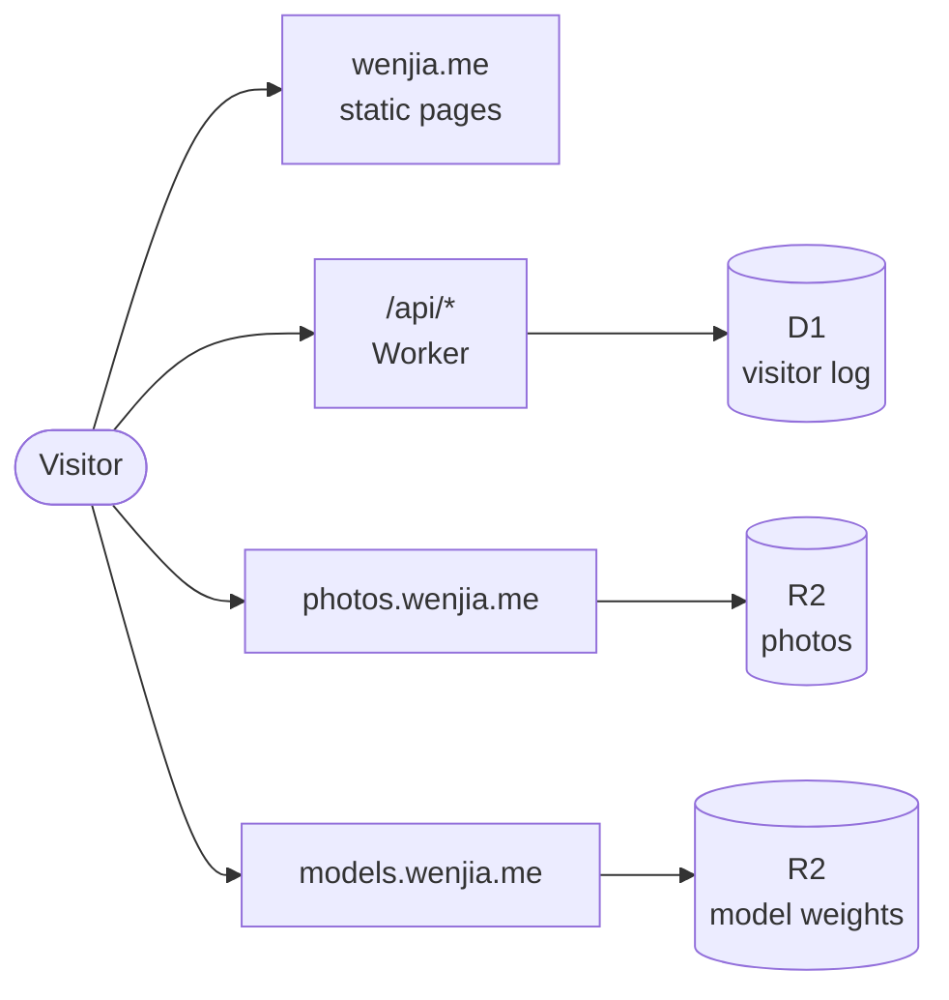
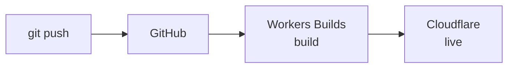
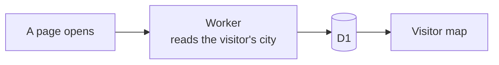

My old homepage was a Jekyll academic template on GitHub Pages. It worked, but every time I wanted to add something of my own, I first had to read a template someone else had written.

So this time I tore it down and started again. The new site has no server of its own, yet a cat lives in it that can chat, there is a globe you can drag around, and at the very bottom of the page there is a map of visitors. The whole thing was done together with Claude Code. I said what I wanted and chose between options, and it wrote the code and ran the checks.

This post takes the site apart, covering what it uses, why I chose it, and where I fell into a trap. It is not short, so feel free to read only the parts that interest you.

## The whole picture first



The whole site comes down to three things, namely a pile of static files, two API addresses and two storage buckets.

The body of the site is purely static. The build produces a set of HTML, CSS and JS files, and those files are what a visitor receives, with no program running in between. Only two addresses under `/api/` execute any code. One keeps the visitor log and the other feeds the visitor map. Large files such as photos and model weights sit in storage buckets of their own, and the pages only point to them.

## Why Astro

A personal homepage has one defining trait, which is that nine tenths of it is text that does not move. A bio, a list of papers, blog posts. Once written, they are done.

Many front-end frameworks hand the whole page to JavaScript by default and render it a second time in the visitor's browser. For a site that is mostly text, that makes visitors pay in bandwidth for something they never use. Jekyll is purely static, but adding a little interaction inside its templates is awkward.

[Astro](https://astro.build) stands right in the middle. By default it outputs plain HTML with not one line of JavaScript, and only the parts that need interaction load a script of their own. There is no React on this site, and no Vue. The globe's code loads only on the Misc page, and the visitor map's code is not fetched until you have nearly scrolled to the bottom. The diagrams you are looking at work the same way. The Mermaid library that draws them is not small, and only posts with a diagram load it.

The other thing I like is how content is managed. Papers and blog posts are Markdown files, and each kind has an agreed set of fields. Here is the one for blog posts.

```ts
const blog = defineCollection({
  loader: glob({ pattern: '**/*.{md,mdx}', base: './src/content/blog' }),
  schema: z.object({
    title: z.string(),
    date: z.coerce.date(),
    lang: z.enum(['en', 'zh']).default('en'),
    draft: z.boolean().default(false),
  }),
});
```

A malformed date or a missing title makes the build fail on the spot, so a broken page never goes live. Adding a paper means adding one file, and the selection on the homepage, the list on the publications page and the cat's knowledge all follow.

Astro also optimises images along the way. At build time the images in a page are converted to WebP and produced at several widths, and the browser picks the one that suits the screen.

## Colours taken from a painting


The colours do not come from a ready-made palette. They were taken from Monet's *Impression, Sunrise*. The teal of the harbour's morning mist is the main colour, the small orange of the sun is the second accent, and the background is a warm off-white, like unpainted canvas.

<div class="swatches">
<span style="--c:#f5f5f0"><b>Canvas</b><code>#f5f5f0</code></span>
<span style="--c:#fbfbf8"><b>Paper</b><code>#fbfbf8</code></span>
<span style="--c:#1b2a2a"><b>Ink</b><code>#1b2a2a</code></span>
<span style="--c:#5d6b6a"><b>Grey-green</b><code>#5d6b6a</code></span>
<span style="--c:#dce2df"><b>Hairline</b><code>#dce2df</code></span>
<span style="--c:#2f6260"><b>Harbour teal</b><code>#2f6260</code></span>
<span style="--c:#dbe8e6"><b>Pale teal</b><code>#dbe8e6</code></span>
<span style="--c:#b9552c"><b>Sunrise orange</b><code>#b9552c</code></span>
</div>

The orange is used sparingly and appears in only a few places, among them the emphasised words of the homepage headline, the side branches and advisors' names in the career section, the answer the cat is generating, and the dots on the visitor map. A colour that is everywhere is no longer an accent.

The dark theme is not simply the light one inverted. I tuned it as the same painting at night.

<div class="swatches">
<span style="--c:#0e1717"><b>Night</b><code>#0e1717</code></span>
<span style="--c:#142121"><b>Surface</b><code>#142121</code></span>
<span style="--c:#e4eae8"><b>Text</b><code>#e4eae8</code></span>
<span style="--c:#93a3a2"><b>Grey-green</b><code>#93a3a2</code></span>
<span style="--c:#253433"><b>Hairline</b><code>#253433</code></span>
<span style="--c:#7fc3bd"><b>Harbour teal</b><code>#7fc3bd</code></span>
<span style="--c:#183635"><b>Deep teal</b><code>#183635</code></span>
<span style="--c:#f0926c"><b>Sunrise orange</b><code>#f0926c</code></span>
</div>

There are five paler colours as well, used only to tint tokens in the homepage headline's generation animation. Their names also come from things in Monet's paintings.

<div class="swatches">
<span style="--c:#f3d4dc"><b>Lily pink</b><code>#f3d4dc</code></span>
<span style="--c:#f1e7b8"><b>Sunlight yellow</b><code>#f1e7b8</code></span>
<span style="--c:#cfe7d2"><b>Leaf green</b><code>#cfe7d2</code></span>
<span style="--c:#cfe0ef"><b>Water blue</b><code>#cfe0ef</code></span>
<span style="--c:#ddd6ef"><b>Wisteria</b><code>#ddd6ef</code></span>
</div>

The implementation is plain. Each colour is a CSS variable, the dark theme simply gives the same variable names another set of values, and components only ever write `var(--accent)`. If you have switched the theme by hand, that choice is remembered in your browser and applied before the page is first painted, so there is no flash of the light theme.

At the top of each page there is also a Monet that fades into the background. The publications page has *Impression, Sunrise*, the blog has *Water Lilies*, the photos page has *Woman with a Parasol*, and Misc has the Japanese footbridge.

## Typefaces

<div class="specimen">
<p style="font-family:var(--serif);font-size:1.7rem"><small>Newsreader, for headings and long English text</small>Building code agents for <em>the real world.</em></p>
<p style="font-family:var(--sans);font-size:1.05rem"><small>Inter with the system's Chinese typeface, for the interface and Chinese text</small>Research Engineer，正在做基于大模型的代码智能体。</p>
<p style="font-family:var(--mono);font-size:0.9rem"><small>The system's monospace, for code, dates and numbers</small>$ git log --graph career　　scholar.open()　　Sep 2026</p>
</div>

The typefaces on the site play three roles.

Headings and long English text use [Newsreader](https://fonts.google.com/specimen/Newsreader), a serif designed for long reading on screens. It is a variable font with an optical size axis, so at large sizes the strokes have more contrast and finer detail, and at small sizes it is sturdier and easier to make out. One font file gives headlines and body text each their own cut.

The interface and Chinese text use [Inter](https://rsms.me/inter/), together with the Chinese typeface already on the visitor's system. I do not make visitors download a Chinese font, because one easily runs to several megabytes, while PingFang, Microsoft YaHei and Noto Sans are already on everyone's device. Code, dates and numbers use the system's monospace, which also needs no download.

Newsreader and Inter are hosted with the site itself through the Fontsource npm packages and do not go through Google Fonts. The three most used font files are preloaded at the top of the page, to keep text from appearing in another typeface first and then jumping to the final one.

Chinese and English posts are also set differently. English uses the serif at a line height of 1.7. Chinese switches to the sans-serif, with the line height opened to 1.9, justified, and punctuation kept from starting a line.

```css
.prose:lang(zh) {
  font-family: var(--sans);
  line-height: 1.9;
  text-align: justify;
  line-break: strict;
}
```

A fourth typeface hides on the Misc page. The achievements board uses the pixel font Pixelify Sans, only 12 KB and loaded only on that page. The level number on the board is the exception and uses the monospace, because in the pixel font a 5 looks too much like an S.

## A few small touches on the homepage

The homepage headline is generated bit by bit. It imitates the way a language model decodes, appearing token by token. What has not been generated yet shows as noise of the same shape, and a small chart beside it draws a next-token distribution from which one bar is sampled at each step. The real text is in the HTML all along and the noise is only laid over it, so search engines can read it, people who turn animations off still see it, and the layout never shifts.

A few of the outbound links on the homepage are written as tool calls. Google Scholar is `scholar.open()` and GitHub is `github.pull()`. People who build agents will probably smile.

The career section is drawn as `git log --graph`. The main line is a commit history, an internship is a branch pulled off to the side, and when it ends it merges back.

## The cat at the bottom of the screen

Pop Cat, at the bottom of the screen, is a real language model. It is Qwen3.5 0.8B, running in your own browser through [WebLLM](https://webllm.mlc.ai), on your graphics card, which is to say on WebGPU. There is no inference server behind it and no API key.

The weights download only when you ask your first question. They are about 430 MB and then stay in the browser's cache. The model runs in a background thread, so the page does not freeze while it thinks. If your browser does not support WebGPU, the cat tells you so as soon as you open the chat box and switches the input off, so you are never left stuck after clicking.

The weights are in my own R2 bucket. WebLLM downloads from Hugging Face by default, and that address cannot be reached from mainland China. R2 has another advantage in that download traffic is free, which matters for a 430 MB file.

What the cat knows about me is not written by hand. At build time a script puts the site's career, papers and achievements together into a profile and hands it over, so when I edit my career, the cat changes its story too.

Small models do not quite do as they are told. I wanted every sentence to end in meow, and a 0.8B model cannot keep that up consistently. The fix is blunt. I stopped counting on it, and once it has finished writing, code changes every sentence to end in meow. Language is a similar case. When a question is in Chinese, the instruction to answer in Chinese has to be said both before and after the question, because a small model tends to answer in the language it read first and last.

## The globe

The Misc page has a globe marking the places I have been.

The first version used a dot-matrix style library that draws coastlines as small dots. It looks cool from a distance and turns to mush when you zoom in. I then switched to drawing it myself on a canvas, with [d3-geo](https://d3js.org/d3-geo) for the orthographic projection and [Natural Earth](https://www.naturalearthdata.com) vector data for coastlines and borders. Vector data stays sharp at any zoom, and the whole world map is only about a hundred KB.

The place names have to keep out of each other's way. A name is written to the right of its dot by default. If the right is taken it goes on the left, and if neither side has room only the dot is drawn, and the name appears once you zoom in.

Two interesting problems came up during the rewrite.

For a while, the globe was a plain disc with no land. The script reads its colours from CSS variables, and the page still had the old version's variable names, while the new ones were simply not defined. Giving a canvas an empty colour value raises no error. It quietly keeps the previous colour, so land, sea and lines all came out the same.

The other problem was in zooming. After zooming in four times and out four times, the zoom-out button did not turn grey. Each step multiplies or divides by 1.6, and after the round trip a floating-point number is not exactly 1 but a tiny bit more, so the program thought there was still room to zoom out.

## Why move to Cloudflare and not stay on GitHub Pages

The old site had always been on GitHub Pages. It is free and carefree, and a push puts it live. The new site did not stay there because what it has to do goes beyond what GitHub Pages covers.

GitHub Pages does one thing, which is to send the files in a repository to visitors as they are. It cannot run server-side code, so there is nowhere to put the API for the visitor log, let alone a database. It also limits size. A site may not exceed 1 GB and a file over 100 MiB in a repository is refused outright, while the cat's model weights are 430 MB and the photos will keep piling up. Nor does it let you configure response headers or redirects. As you will see later, it cannot even do something as small as a 301 from the old address to the new one.

These things could of course be spread over several services, with the static pages left on GitHub, the API on some cloud function, and the files on some object store. I did not want to maintain three accounts and three ways of deploying. Cloudflare puts them all in one place, each of them has a free allowance, and this site's usage is nowhere near the ceiling of any of them.

Here are the Cloudflare parts this site uses.

| Part | What it does on this site | Free allowance |
| --- | --- | --- |
| Workers static assets | Hosts every page file the build produces | Requests are free and unlimited, up to 20,000 files per version and 25 MiB per file |
| Workers | Runs the two API addresses under `/api` | 100,000 requests a day, 10 ms of CPU time per request |
| D1 | Holds the visitor log and the data for the visitor map | 500 MB per database, 5 million rows read and 100,000 rows written a day |
| R2 | Holds the photos and the model weights | 10 GB of storage a month, download traffic free |
| Workers Builds | Builds and publishes after each push | 3,000 build minutes a month |
| Rate Limiting | Limits requests to the API | Used together with Workers |
| Cron Triggers | Checks the database once a day | 5 scheduled triggers per account |
| Email Service | Emails me when the database needs attention | Sending to your own verified address is not charged |
| Workers AI | Translates blog posts, called only when I run the script on my computer | 10,000 Neurons a day |

The first two rows deserve a few more words, because they are really two sides of one Worker. A Worker can carry a set of static files and it can carry a piece of code. Requests for the static files are free and unlimited and never start that code. Only the `/api/*` paths that I name in the configuration are handed to the code, and those requests count against the hundred thousand a day. For a personal site this means that the pages can be visited any number of times at no cost, and the only thing to keep an eye on is the log API.

D1 is SQLite running on Cloudflare. It has no connection strings or ports. What a Worker receives is simply an object that executes SQL. The table definitions live in the repository's `migrations/` directory and are applied to the live database with one command.

R2 is object storage with an S3-compatible API. I have two buckets, one for photos and one for model weights, each bound to a subdomain. Its biggest difference from the others is that download traffic is free. It charges only for the amount stored and the number of operations.

The rest are small parts. Workers Builds builds and publishes after a push, Cron Triggers wakes the Worker once a day to check the database, Email Service lets the Worker send me a warning, and Workers AI is called only when I run the translation script on my own computer.

GitHub has not left the stage. The code is still on GitHub, a push is still where publishing starts, and the redirect pages for the old address are still published by GitHub Pages. It has simply changed from the place that hosts the site into the place that keeps the code and triggers the build.

## wrangler, and why not deploy with GitHub Actions

Everything on the Cloudflare side is operated through wrangler. It is Cloudflare's official command-line tool, and anything in this project that touches Cloudflare goes through it.

The wiring of all the parts is written in a single configuration file, with a few lines each for the Worker's entry point, the static file directory, the database, the rate limit, the schedule and email. Here is an excerpt.

```jsonc
{
  "name": "wenjia-me",
  "routes": [{ "pattern": "wenjia.me", "custom_domain": true }],
  "main": "worker/index.ts",
  "assets": {
    "directory": "./dist",
    "binding": "ASSETS",
    "run_worker_first": ["/api/*"]
  },
  "d1_databases": [{ "binding": "DB", "database_name": "wenjia-me", "database_id": "..." }],
  "ratelimits": [{ "name": "API_LIMIT", "namespace_id": "1001", "simple": { "limit": 60, "period": 60 } }],
  "triggers": { "crons": ["0 1 * * *"] },
  "send_email": [{ "name": "EMAIL" }]
}
```

The `run_worker_first` line is the naming I mentioned above. Apart from the paths it lists, every address returns a static file directly.

The commands in daily use are few. `wrangler dev` runs the whole site on my computer, with local stand-ins for the database, the rate limiter and email, so the API can be tested there first. `wrangler deploy` publishes the build output together with the Worker. `wrangler d1 migrations apply` updates the tables, and `wrangler d1 execute` runs SQL directly against the live database, which is how I read the log. The script that adds photos calls `wrangler r2 object put` inside.

There were two ways to deploy automatically. One is GitHub Actions, where a workflow in the repository has GitHub's machines build after each push and then call wrangler to publish. That needs an API token generated in Cloudflare and stored among GitHub's secrets, and the workflow file has to be maintained. The other is Cloudflare's own Workers Builds, where the Worker is connected to the GitHub repository in the dashboard, and after each push Cloudflare pulls the code itself, runs `npm run build`, and then runs `npx wrangler deploy`.

I chose the latter. No secret has to leave Cloudflare, the repository needs no workflow file, and the build log is right on the Worker's page. The commands it runs are exactly the ones I would type to publish by hand, so when something goes wrong it is easy to reproduce on my own computer.



From push to live takes about a minute. Having written this post, all I have to do is one `git push`.

The old address, `jwj1342.github.io`, still works, thanks to a small trick. GitHub Pages cannot be configured to send 301 redirects, so I have it publish a very small branch holding just two pages, whose job is to take the visitor to the same path on wenjia.me.

```html
<script>
  location.replace('https://wenjia.me' + location.pathname + location.search + location.hash);
</script>
```

One of the two pages is `404.html`, and that is the key to the whole trick. No address of the old site exists in the new branch, so every one of them lands on the 404 page and is taken to the new site. Once there, old publication links are matched to their new pages by a table of redirects, which is exactly the kind of configuration Cloudflare supports and GitHub Pages does not.

## The visitor map and the log

The visitor map at the bottom of the homepage is the only place where this site uses a back end.



The back end is the Worker described above, about two hundred lines of it. Each page reports to `/api/log` once when it opens, using `sendBeacon`. Cloudflare attaches its estimate of the visitor's location to every request, in `request.cf`, down to the city. The Worker only has to read the city and write it to D1, and no third-party analytics script is needed. The map on the homepage then fetches those cities back from a second address and draws them as dots. It is drawn with the same d3-geo and Natural Earth data as the globe, with the orthographic projection swapped for the flat Natural Earth projection.

I set myself a few rules. No IP addresses are stored, no cookies are set, and location goes only to the city. The pages of one visit are tied together by a random id that is valid only in the current browser tab, and when the tab is closed it is gone.

The questions Pop Cat receives, and its answers, are logged too, so that I can see what people ask. The chat box says so. The model really does run on your machine, but the questions are recorded, and you should know that.

### A rate limit that did not quite work

An API open to the internet has to be guarded against flooding. Cloudflare provides Workers with a rate limiter, which I set to 60 requests a minute per visitor and then dutifully tested.

A burst of 150 concurrent requests all went through. Then 300 more over half a minute, of which only 8 were refused.

Only when I went back to the documentation did it make sense. It says plainly that the limit is approximate, that each Cloudflare location counts separately and the counts are synchronised in the background, and that requests exceeding the configured number are to be expected. For one strict worldwide limit, it suggests building your own with Durable Objects.

I was going to stack a strict limit on top accordingly, and then took a different approach. If a personal site gets flooded, the worst outcome is that the day's logging allowance runs out, and the site itself is unaffected. So what happens now is that the Worker checks the database on a schedule once a day, and if it is more than 80% full, or an abnormal number of log lines were written in a day, it sends me an email, and I export and clean up. That is enough, and easier to maintain.

## Odds and ends

A few more small things. None of them makes a section, but each took time.

The star and citation counts next to papers are fetched at build time from GitHub and OpenAlex, and refreshed once more in the browser after the page opens. GitHub's anonymous API allows only 60 requests an hour from one IP address, and on a campus network or conference Wi-Fi many people share one address, so the numbers a browser fetches are kept locally for an hour and not requested again in that time, and when a lookup fails the last saved number is used.

Styles on old phones caused trouble. The build tool by default rewrites media queries into a newer syntax that Safari before 16.4 does not understand, and it ignores the whole rule. The fix is to tell the build tool that the CSS it outputs must be readable by old browsers.

Photos stay out of Git. Adding photos is one command. A script makes a thumbnail and a large view, strips the location data from the photo, uploads both to R2, and records the size and main colour in a JSON file. The main colour fills the space before the image has loaded.

The background of the achievements board is not an image. It is a pixel texture computed at build time from a fixed random seed, so it is identical on every build.

## In closing

Counting back, the page side uses Astro and TypeScript, with [KaTeX](https://katex.org) and [Shiki](https://shiki.style) for math and code highlighting, [Mermaid](https://mermaid.js.org) for the diagrams, d3-geo with Natural Earth data for the maps, [PhotoSwipe](https://photoswipe.com) for the full-size view on the photo wall, and WebLLM with WebGPU to run the cat. The service side is all on Cloudflare, and the table above lists every part.

All the source is on [GitHub](https://github.com/jwj1342/jwj1342.github.io), and if you want to see how some part is written, go and look. The cat at the bottom of the screen can also answer questions about me, though it is only a 0.8B model, so do not take it too seriously when it gets something wrong.
