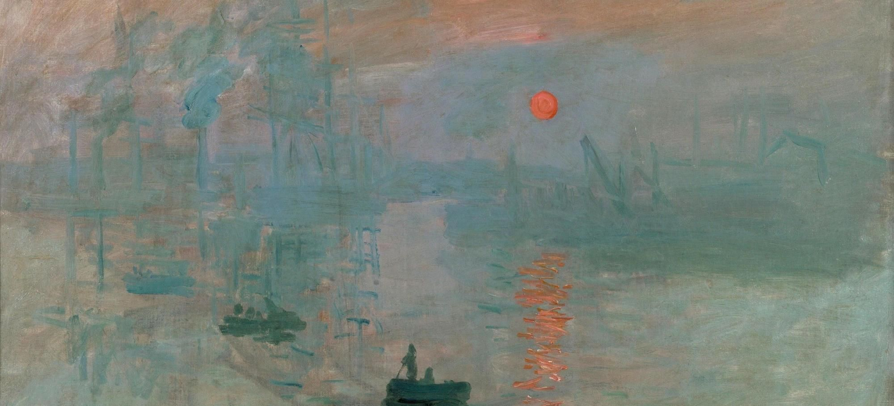
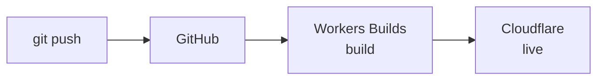
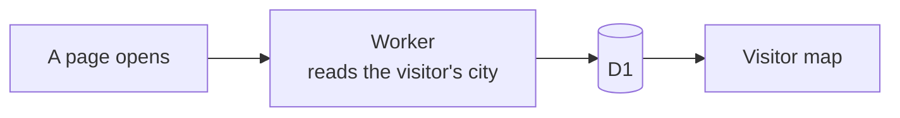

My old homepage had always worn a Jekyll academic template, sitting on GitHub Pages. It worked well enough, but every time I wanted to add something of my own I first had to dig through a template someone else had written, and changing it never felt right.

So this time I simply tore it down and started over. The new site does not even have a server of its own, and still I managed to stuff quite a few fun things into it. A cat that really runs a language model squats at the bottom of the screen, the Misc page has a globe you can drag around, and at the very bottom of the homepage there is a map of visitors. Almost all of it was done in tandem with Claude Code. I asked for things and made the calls, and it wrote the code and ran the checks.

Here is how it came together, why I chose what I chose, and which traps I walked into along the way.

## The whole picture first


Put plainly, it is three things, a pile of static files, two API addresses and two storage buckets.

The pages are all HTML, CSS and JS produced at build time. A visitor arrives, takes the files and leaves, and no program runs in between. The only addresses that execute code are the two under `/api/`, one that keeps the visitor log and one that feeds the visitor map. As for big things like photos and model weights, I threw them into storage buckets of their own and left only an address in the page.

## Why Astro

Once I had one thing clear, choosing was easy. Nine tenths of a personal homepage is text that does not move. A bio, a list of papers, blog posts. Once written, they are done.

And yet many front-end frameworks insist on handing the whole page to JavaScript and rendering it a second time in the visitor's browser. For a site that is mostly text, that means making visitors pay in bandwidth for something they will never use. Jekyll is purely static, to be fair, but I had already learned how awkward it is to add interaction inside its templates.

[Astro](https://astro.build) sits right in between. By default it puts out plain HTML with not a single line of JavaScript, and only the parts that need interaction load a script of their own. So there is no React on this site, and no Vue. The globe's code loads only on the Misc page, and the visitor map's code is not fetched until you have nearly scrolled to the bottom. Even the diagrams you are looking at work this way. The Mermaid library that draws them is no lightweight, and only posts with a diagram invite it in.

Managing content is a pleasure too. Papers and blog posts are Markdown files, each kind has an agreed set of fields, and the one for blog posts looks like this.

```ts
const blog = defineCollection({
  loader: glob({ pattern: '**/*.{md,mdx}', base: './src/content/blog' }),
  schema: z.object({
    title: z.string(),
    date: z.coerce.date(),
    lang: z.enum(['en', 'zh']).default('en'),
    draft: z.boolean().default(false),
  }),
});
```

If my hand slips one day and I mistype a date or leave out a title, the build fails on the spot and the broken page never makes it online. Adding a paper is just adding one file, and the selection on the homepage, the list on the publications page and even the cat's knowledge all follow.

Image optimisation comes for free. At build time images are converted to WebP and produced at several widths, the browser picks the one that fits, and I do not have to do a thing.

## Colours taken from a painting



I like Monet's paintings, so I did not go looking for a ready-made palette and took the colours straight from *Impression, Sunrise*. The teal of the harbour's morning mist is the main colour, that small orange of the sun is the second accent, and the background is a warm off-white, like a canvas that has not been painted yet.

<div class="swatches">
<span style="--c:#f5f5f0"><b>Canvas</b><code>#f5f5f0</code></span>
<span style="--c:#fbfbf8"><b>Paper</b><code>#fbfbf8</code></span>
<span style="--c:#1b2a2a"><b>Ink</b><code>#1b2a2a</code></span>
<span style="--c:#5d6b6a"><b>Grey-green</b><code>#5d6b6a</code></span>
<span style="--c:#dce2df"><b>Hairline</b><code>#dce2df</code></span>
<span style="--c:#2f6260"><b>Harbour teal</b><code>#2f6260</code></span>
<span style="--c:#dbe8e6"><b>Pale teal</b><code>#dbe8e6</code></span>
<span style="--c:#b9552c"><b>Sunrise orange</b><code>#b9552c</code></span>
</div>

I am stingy with the orange. It shows up in only a few places, such as the emphasised words of the homepage headline, the side branches and advisors' names in the career section, the answer the cat is generating, and the dots on the visitor map. If a colour is everywhere, it is hardly an accent any more.

For the dark theme I did not take the lazy route of inverting the light one. I tuned it again from scratch as the same painting at night.

<div class="swatches">
<span style="--c:#0e1717"><b>Night</b><code>#0e1717</code></span>
<span style="--c:#142121"><b>Surface</b><code>#142121</code></span>
<span style="--c:#e4eae8"><b>Text</b><code>#e4eae8</code></span>
<span style="--c:#93a3a2"><b>Grey-green</b><code>#93a3a2</code></span>
<span style="--c:#253433"><b>Hairline</b><code>#253433</code></span>
<span style="--c:#7fc3bd"><b>Harbour teal</b><code>#7fc3bd</code></span>
<span style="--c:#183635"><b>Deep teal</b><code>#183635</code></span>
<span style="--c:#f0926c"><b>Sunrise orange</b><code>#f0926c</code></span>
</div>

There are five paler colours as well, used only to tint tokens in the homepage headline's generation animation. I took their names from Monet's paintings too, while I was at it.

<div class="swatches">
<span style="--c:#f3d4dc"><b>Lily pink</b><code>#f3d4dc</code></span>
<span style="--c:#f1e7b8"><b>Sunlight yellow</b><code>#f1e7b8</code></span>
<span style="--c:#cfe7d2"><b>Leaf green</b><code>#cfe7d2</code></span>
<span style="--c:#cfe0ef"><b>Water blue</b><code>#cfe0ef</code></span>
<span style="--c:#ddd6ef"><b>Wisteria</b><code>#ddd6ef</code></span>
</div>

The implementation, on the other hand, could not be plainer. Each colour is a CSS variable, the dark theme does nothing more than give the same variable names another set of values, and components write `var(--accent)` from start to finish. If you have switched the theme by hand, the choice is remembered in your browser and applied before the page is even painted, so there is no flash of the light theme.

Hidden at the top of each page there is also a Monet that fades into the background. The publications page has *Impression, Sunrise*, the blog has *Water Lilies*, the photos page has *Woman with a Parasol*, and Misc has the Japanese footbridge.

## Typefaces

<div class="specimen">
<p style="font-family:var(--serif);font-size:1.7rem"><small>Newsreader, for headings and long English text</small>Building code agents for <em>the real world.</em></p>
<p style="font-family:var(--sans);font-size:1.05rem"><small>Inter with the system's Chinese typeface, for the interface and Chinese text</small>Research Engineer，正在做基于大模型的代码智能体。</p>
<p style="font-family:var(--mono);font-size:0.9rem"><small>The system's monospace, for code, dates and numbers</small>$ git log --graph career　　scholar.open()　　Sep 2026</p>
</div>

The typefaces ended up with three roles.

Headings and long English text go to [Newsreader](https://fonts.google.com/specimen/Newsreader). What won me over is its optical size axis. With one font file, it is fine and delicate when enlarged for a headline and sturdy and legible when shrunk for body text, so I do not need to find one face for each.

The interface and Chinese text use [Inter](https://rsms.me/inter/), and for the Chinese part I simply borrow the typeface already on the visitor's system. Making people download several megabytes of Chinese font just to look at my homepage is something I cannot bring myself to do, and besides, PingFang, Microsoft YaHei and Noto Sans have long been sitting on everyone's device. Code, dates and numbers use the system's monospace, which likewise costs not one byte of download.

Newsreader and Inter are hosted along with the site through the Fontsource npm packages and do not go through Google Fonts. I have the page preload the three most used font files right at the top, so that text does not show its face in another typeface first and then suddenly jump to the final one.

I also tuned Chinese and English posts separately. English uses the serif, and a line height of 1.7 is enough. Chinese switches to the sans-serif and needs the line height opened to 1.9 before it stops feeling cramped, plus justification, and punctuation is not allowed to start a line.

```css
.prose:lang(zh) {
  font-family: var(--sans);
  line-height: 1.9;
  text-align: justify;
  line-break: strict;
}
```

There is in fact a fourth typeface hidden on the Misc page, the pixel font Pixelify Sans used by the achievements board, only 12 KB and loaded only on that page. I did not dare use it for the level number on the board, though, because in a pixel font a 5 really does look too much like an S.

## A few small touches on the homepage

The homepage headline is not simply shown. It is generated bit by bit, in imitation of a language model decoding, popping out one token at a time. What has not been generated yet shows as noise of the same shape, and a small chart beside it draws a next-token distribution, from which one bar is sampled at every step. It looks fancy, but the real text sits quietly in the HTML the whole time and the noise is only a layer on top. So search engines still read it, people who turn animations off still see it, and the layout does not shake.

I did not spare the outbound links either and wrote them all as tool calls. Google Scholar is `scholar.open()` and GitHub is `github.pull()`. Friends who build agents should get a laugh out of it.

The career section I just drew as `git log --graph`. The main line is a commit history, an internship is a branch pulled off to the side, and when it is over it merges back.

## The cat at the bottom of the screen

That Pop Cat at the bottom of the screen is not a decoration. It is a genuine language model, Qwen3.5 0.8B to be exact, running in your own browser through [WebLLM](https://webllm.mlc.ai), on your graphics card, which is to say on WebGPU. There is no inference server behind it and no API key, and I do not pay a cent for inference.

Of course people cannot be made to download a model the moment they open the page. The weights do not start downloading until you ask your first question. They are about 430 MB and then stay in the browser's cache. The model runs in a background thread, so the page does not freeze while it is deep in thought. And if your browser does not support WebGPU, the cat says outright that it cannot wake up the moment you open the chat box, and switches the input off while it is at it, so you are not left stuck after clicking.

Where to keep the weights was a problem. WebLLM downloads from Hugging Face by default, but that address simply cannot be reached from mainland China. In the end I mirrored them into my own R2 bucket, and since R2 does not charge for download traffic, a 430 MB file can be downloaded as often as anyone likes.

Not one sentence of what the cat knows about me was written for it by hand. At build time a script puts the site's career, papers and achievements together into a profile and hands it over, so when I change my career on my side, it changes its story on its side.

The funniest part is that this cat does not quite do as it is told. I wanted every sentence to end in meow, but a 0.8B model has a very limited memory and forgets as it goes. Reasoning with it did not work, so I stopped reasoning. I wait until it has finished writing and then have code force the end of every sentence into a meow. Language has the same problem. You ask in Chinese and it may well answer in English, and it turned out that the instruction to answer in Chinese has to be tucked in both before and after the question to work, because a small model would rather listen to what it read first and last.

## The globe

The Misc page has a globe marking the places I have been.

The first version just used a dot-matrix style library, with coastlines pieced together from small dots. It looks rather cool from a distance, but zoom in and it turns into a blur. So I tore it down and drew it again, on a canvas of my own, with [d3-geo](https://d3js.org/d3-geo) for the orthographic projection and [Natural Earth](https://www.naturalearthdata.com) vector data to trace the coastlines and borders. The good thing about vectors is that they never blur however far you zoom, and the whole world map is only about a hundred KB.

Once there are many place names they start to fight, so they also have to make way for each other. The rule is not complicated. A name is first written to the right of its dot, if the right is taken it moves to the left, and if there is no room on either side only the dot stays, and the name is let out once you zoom in.

Two traps from the redrawing stuck with me.

The first was this. I finished redrawing, opened the page, and the globe had become a plain disc with no land, while the console was spotless, without a single error. It took a round of searching to find out that the script reads its colours from CSS variables, and the page still carried the old version's variable names, with the new ones not defined at all. And of all things, a canvas handed an empty colour value does not raise an error. It just quietly carries on with the previous colour, so land, sea and lines were all painted the same.

The second was better hidden. Zoom in four times and out four times and you should be back where you started, yet the zoom-out button did not turn grey. The reason is that each step multiplies or divides by 1.6, and after the round trip a floating-point number is not exactly 1 but the tiniest bit more, so the program solemnly concluded that there was still room to zoom out.

## An achievements board modelled on Minecraft

The thing on the Misc page that took the most care is in fact the board of life achievements. I like playing Minecraft, so it is modelled on the game's advancements screen. A main line runs from top to bottom through each stage of life, the achievements unlocked in a stage branch off to the side, the locked ones are grey, and those marked secret show nothing but three question marks.

Some of the source code for this part borrows from a project by my good friend He Geng, and I would like to thank him here.

What pixel art fears most is blur. Let a single edge miss the pixel grid, or let a little rounding or a gradient creep in somewhere, and the flavour is gone at once. So the whole board recognises one unit only. One pixel is set to 3px, and outlines, highlights and shadows, and the wires between achievements are all whole multiples of it. The raised look of a tile is not a texture either. It is three layers of box-shadow stacked up, a dark outline on the outside, a bright edge inside the top left and a dark edge inside the bottom right, and together they look like a block standing proud of the surface.

```css
.tile {
  box-shadow:
    0 0 0 var(--px) var(--outline),
    inset var(--px) var(--px) 0 rgba(255, 255, 255, 0.45),
    inset calc(-1 * var(--px)) calc(-1 * var(--px)) 0 rgba(0, 0, 0, 0.3);
}
```

We drew the icons square by square and used no assets from the game. Each icon is a 14 by 14 grid, which in the code is simply 14 strings, with one character per pixel, a dot for transparent, and a letter that is looked up in a palette. The pickaxe below is the badge at the top left of the board.

```ts
pickaxe: [
  '..............',
  '...kkkkkkk....',
  '..kSSSSSSSk...',
  '.kSsskkkksSk..',
  '.kskk..kWksSk.',
  '..k...kWwkksk.',
  '.....kWwk..kk.',
  '....kWwk......',
  '...kWwk.......',
  '..kWwk........',
  '.kWwk.........',
  '.kwk..........',
  '..k...........',
  '..............',
],
```

The palette has 14 colours in all, and each material takes a pair of letters, lower case for the dark side and upper case for the light side. `w` and `W` are wood, `s` and `S` are stone and iron, `g` and `G` are gold. Recolouring an icon means changing letters, and drawing a new one means filling in one more grid. At build time these strings are turned into small squares in an SVG, with neighbouring pixels of the same colour in a row merged into one rectangle first, so the icons are tiny and their edges stay hard at any size. There are 13 of them so far, among them a pickaxe, an axe, a sword, a book, a gem and a star.

The background of the board looks like a dirt texture, but it is not an image either. It is a 12 by 12 pixel texture computed at build time from a fixed random seed, picking from six earth colours and then tiled. The seed is fixed, which is why it comes out identical on every build.

The experience bar keeps to the rules of the game as well. Each unlocked achievement adds 100 experience by default, level 2 takes 200, every level after that takes 100 more than the last, and the bar is cut into 18 segments. The lettering on the board is the pixel font mentioned earlier, with the level and experience numbers as the only exception, for the reason already given, that in a pixel font a 5 looks too much like an S.

One more thing sets it apart from the rest of the site. The board does not follow the light and dark themes. It has a fixed set of colours of its own, like a small game window set into the page.

## Why move to Cloudflare and not stay on GitHub Pages

To be honest, GitHub Pages is rather good. It is free and carefree, a push puts it live, and the old site had always lived there. The trouble is that it could not catch a single one of the things the new site wants to do.

GitHub Pages does exactly one thing, which is to send the files in a repository to visitors as they are. It cannot run server-side code, so the API for the visitor log has nowhere to go, and a database is out of the question. It is tight on size too. A site may not exceed 1 GB and a file over 100 MiB in a repository is refused outright, while the cat's model weights alone are 430 MB and the photos will only pile up. It will not even let you configure response headers or redirects. As you will see below, it cannot manage something as small as a 301 from the old address to the new one.

I could of course have cobbled things together, with the pages left on GitHub, the API on some cloud function and the files on some object store. But I really did not want to look after three accounts and three ways of deploying for the sake of one personal homepage. Cloudflare puts all of these in one place, each with a free allowance, and at this site's level of use I am a long way from the ceiling of any of them.

I have put the parts I use in a table.

| Part | What it does on this site | Free allowance |
| --- | --- | --- |
| Workers static assets | Hosts every page file the build produces | Requests are free and unlimited, up to 20,000 files per version and 25 MiB per file |
| Workers | Runs the two API addresses under `/api` | 100,000 requests a day, 10 ms of CPU time per request |
| D1 | Holds the visitor log and the data for the visitor map | 500 MB per database, 5 million rows read and 100,000 rows written a day |
| R2 | Holds the photos and the model weights | 10 GB of storage a month, download traffic free |
| Workers Builds | Builds and publishes after each push | 3,000 build minutes a month |
| Rate Limiting | Limits requests to the API | Used together with Workers |
| Cron Triggers | Checks the database once a day | 5 scheduled triggers per account |
| Email Service | Emails me when the database needs attention | Sending to your own verified address is not charged |
| Workers AI | Translates blog posts, called only when I run the script on my computer | 10,000 Neurons a day |

The first two rows are really two faces of one Worker. A Worker can carry a set of static files and it can carry a piece of code. Visiting the static files is free and unlimited and does not disturb that code in the slightest. Only the `/api/*` paths that I name in the configuration are handed to the code, and only those requests count against the hundred thousand a day. In other words, the pages can be viewed any number of times at no cost, and the only thing I really have to watch is the log API.

D1 is very little trouble to use. It is simply SQLite running on Cloudflare, with no connection string and no port, and what a Worker gets in its hands is directly an object that executes SQL. The table definitions live in the repository's `migrations/` directory, and one command applies them to the live database.

R2 won me over on a single point, which is that download traffic is free. It is S3-compatible object storage that charges only for how much is stored and how many operations are made. I have two buckets, one for photos and one for model weights, each bound to a subdomain.

The rest are small parts. Workers Builds looks after building and publishing after a push, Cron Triggers wakes the Worker once a day to take a look at the database, Email Service lets the Worker send me a warning, and Workers AI is only ever called when I run the translation script on my own computer.

GitHub has not been laid off either. The code is still on GitHub, a push is still where publishing starts, and the redirect pages for the old address are still served by GitHub Pages. It has only changed from the place where the site lives into the place where the code lives and the build is triggered.

## wrangler, and why not deploy with GitHub Actions

Dealing with Cloudflare takes one tool from beginning to end, its official command line, wrangler.

What I like best is that all the wiring is written in one configuration file. The Worker's entry point, the static file directory, the database, the rate limit, the schedule and email each take a few lines, and one glance shows what the whole back end of the site looks like. Here is an excerpt.

```jsonc
{
  "name": "wenjia-me",
  "routes": [{ "pattern": "wenjia.me", "custom_domain": true }],
  "main": "worker/index.ts",
  "assets": {
    "directory": "./dist",
    "binding": "ASSETS",
    "run_worker_first": ["/api/*"]
  },
  "d1_databases": [{ "binding": "DB", "database_name": "wenjia-me", "database_id": "..." }],
  "ratelimits": [{ "name": "API_LIMIT", "namespace_id": "1001", "simple": { "limit": 60, "period": 60 } }],
  "triggers": { "crons": ["0 1 * * *"] },
  "send_email": [{ "name": "EMAIL" }]
}
```

The `run_worker_first` in there is the naming I mentioned above. Any address it does not name returns a static file directly.

The commands I actually use are just a handful. `wrangler dev` runs the whole site on my computer, with local stand-ins for the database, the rate limiter and email, so I can get the API sorted out on my own machine before it goes live. `wrangler deploy` publishes the build output together with the Worker. Changing the tables is `wrangler d1 migrations apply`, and running SQL straight against the live database is `wrangler d1 execute`, which is how I usually read the log. Even the script that adds photos calls `wrangler r2 object put` inside.

For automatic deployment there were two roads. One is GitHub Actions, with a workflow in the repository that has GitHub's machines build after every push and then call wrangler to publish. The nuisance is that an API token first has to be generated in Cloudflare and stored among GitHub's secrets, and that workflow file has to be kept alive from then on. The other is Cloudflare's own Workers Builds, where the Worker is connected to the GitHub repository in the dashboard, and after that, on every push, Cloudflare pulls the code itself, runs `npm run build`, and then runs `npx wrangler deploy`.

I took the second road for very practical reasons. No secret has to step outside Cloudflare, the repository does not have to keep a workflow file, and the build log hangs right on the Worker's page. More important still, the commands it runs are exactly the ones I type when I publish by hand, so the day something goes wrong I can reproduce it on my own computer.



From push to live takes about a minute. Having finished this post, all I have to do is type `git push` once.

While I am at it, a word about the old address. `jwj1342.github.io` still opens today, thanks to a small trick. GitHub Pages does not support 301 redirects, so I have it publish a very small branch with only two pages in it, whose sole task is to send people to the same path on wenjia.me.

```html
<script>
  location.replace('https://wenjia.me' + location.pathname + location.search + location.hash);
</script>
```

One of the two pages is `404.html`, and the whole trick hinges on it. None of the old site's addresses exist in the new branch, so they all fall through to the 404 page and are sent on to the new site. Once there, old publication links are caught by a table of redirects and matched to their new pages. The irony is that this table is exactly the kind of thing Cloudflare lets you configure and GitHub Pages does not.

## The visitor map and the log

That visitor map at the bottom of the homepage is the only place on the whole site that needs a back end.



The back end is the Worker from before, about two hundred lines all told. As soon as a page opens, it says hello to `/api/log` with `sendBeacon`. The neat part is that I do not have to look up the location myself at all. Cloudflare attaches its estimate of the visitor's location to every request, in `request.cf`, down to the city. The Worker reads the city, writes it to D1, and that is that, without pulling in a single line of third-party analytics script. The map on the homepage then fetches those cities back from a second address and draws them as dots, with the same d3-geo and Natural Earth data as the globe, only with the orthographic projection swapped for the flat Natural Earth projection.

I made myself a few rules about logging. No IP addresses stored, no cookies planted, and location no finer than the city. The pages turned in one visit are strung together by a random id that is valid only in the current browser tab, and once the tab is closed it is gone.

I also keep the questions Pop Cat receives and the answers it gives, because I really am curious what people ask it. The chat box says so plainly. The model does run on your machine, true, but the questions are recorded, and that is not something to keep from you.

### A rate limit that did not quite work

An API hanging out on the public internet has to be guarded against people hammering it. Cloudflare happens to give Workers a rate limiter, so I set it to 60 requests a minute per visitor in passing and then hammered it myself to see whether it would hold.

The result left me staring. A burst of 150 concurrent requests, all let through. Not ready to give up, I kept sending for half a minute, 300 in total, and in the end it stopped only 8. Was this rate limiter just for show?

Only when I went back through the documentation was the case solved. There it is in black and white. The limit is approximate, each Cloudflare location counts on its own, the counts are synchronised slowly in the background, and requests going over the configured number are entirely expected. If you really want one strict worldwide limit, the documentation's advice is to build one yourself with Durable Objects.

I very nearly went and built it, and then thought better of it. If a personal homepage gets hammered, the worst that happens is that the day's logging allowance is used up, and the site itself comes through without a scratch. So the final plan is much plainer. The Worker takes a look at the database on a schedule once a day, and if it is more than 80% full, or an absurd number of log lines came in within a day, it sends me an email, and I go and export and clean up. It is enough, and it is easy to keep alive.

## Odds and ends

Lastly, a few small things that do not deserve a section of their own and yet each took some effort.

The star and citation counts next to papers are grabbed from GitHub and OpenAlex at build time, and the browser refreshes them once more after the page opens. The catch is that GitHub's anonymous API lets one IP address ask only 60 times an hour, and on a campus network or conference Wi-Fi a whole crowd shares one address and uses that up in no time. So the numbers a browser fetches are kept locally for an hour and not asked for again in that time, and if they really cannot be fetched, the last saved number is used.

Styles on old phones caught me out once as well. The build tool by default rewrites media queries into a newer syntax, which Safari before 16.4 does not recognise, and what it does not recognise it throws away, whole rule and all. The fix is simple enough, which is to tell the build tool that the CSS it puts out has to be readable by old browsers too.

Photos do not go into Git. Adding photos takes one command, and the script makes a thumbnail and a large view, wipes the location data from the photo, sends both to R2, and notes the size and main colour in a JSON file. The main colour is kept so that a patch of it can fill the photo's place before the image has loaded.

## In closing

I will stop here. The code is all on [GitHub](https://github.com/jwj1342/jwj1342.github.io), and if you are curious how some part is written, go and have a look.

As for the cat at the bottom of the screen, you can ask it about me. Just remember that it is only 0.8B, and bear with it when it gets something wrong.
