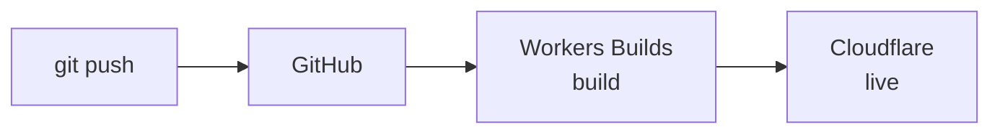
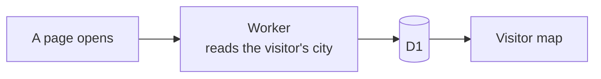

My previous homepage used a Jekyll academic template hosted on GitHub Pages. It worked, but every time I wanted to add something of my own I first had to understand a template someone else had written, which made each change expensive.

So this time I rewrote all of it. The new site has no server of its own and yet does considerably more than the old one. A cat at the bottom of the screen runs a language model, the Misc page has a globe that can be dragged, and the bottom of the homepage shows a map of visitors. The work was done together with Claude Code. I stated the requirements and chose between options, and it wrote the code and verified it.

This post records the structure of the site, the reasoning behind each choice, and a few problems that came up along the way.

## The whole picture first


The site consists of three parts, which are static files, two API addresses and two storage buckets.

The body of the site is static. The pages are generated as HTML, CSS and JS at build time, those files are what a visitor receives, and no program runs in between. The only addresses that execute code are the two under `/api/`, one that records the visitor log and one that supplies data to the visitor map. Photos and model weights are too large to belong in the code repository, so they are kept in storage buckets and the pages only refer to their addresses.

## Why Astro

The choice of Astro starts from what a personal homepage contains. Nine tenths of it is text that does not change, such as a bio, a list of papers and blog posts, and once written it needs no further computation.

Many front-end frameworks hand the whole page to JavaScript by default and render it again in the visitor's browser. For a site that is mostly text, this means visitors download extra code for features they do not use. Jekyll is purely static and does not have this problem, but adding interaction inside its templates is inconvenient, which is one of the reasons I wanted to leave it.

[Astro](https://astro.build) sits between the two. By default it outputs only HTML with no JavaScript at all, and only the parts that need interaction load their own scripts. As a result this site uses neither React nor Vue. The globe's code loads only on the Misc page, and the visitor map's code is requested only when the page has been scrolled close to the bottom. The diagrams in this post follow the same approach. The Mermaid library that draws them is not small, so only posts that contain a diagram load it.

The other reason for choosing it is content management. Papers and blog posts are Markdown files, and each kind of content has an agreed set of fields. The one for blog posts is shown below.

```ts
const blog = defineCollection({
  loader: glob({ pattern: '**/*.{md,mdx}', base: './src/content/blog' }),
  schema: z.object({
    title: z.string(),
    date: z.coerce.date(),
    lang: z.enum(['en', 'zh']).default('en'),
    draft: z.boolean().default(false),
  }),
});
```

With this in place, a malformed date or a missing title makes the build fail, so a faulty page is never published. Adding a paper also takes only one new file, after which the selection on the homepage, the list on the publications page and the cat's knowledge are all updated.

In addition, Astro has image optimisation built in. At build time images are converted to WebP and produced at several widths, and the browser chooses the one that suits the screen.

## Colours taken from a painting


I like Monet's paintings, so the colours do not come from a ready-made palette but directly from *Impression, Sunrise*. The teal of the harbour's morning mist is the main colour, the orange of the sun is the second accent, and the background is a warm off-white close to unpainted canvas.

<div class="swatches">
<span style="--c:#f5f5f0"><b>Canvas</b><code>#f5f5f0</code></span>
<span style="--c:#fbfbf8"><b>Paper</b><code>#fbfbf8</code></span>
<span style="--c:#1b2a2a"><b>Ink</b><code>#1b2a2a</code></span>
<span style="--c:#5d6b6a"><b>Grey-green</b><code>#5d6b6a</code></span>
<span style="--c:#dce2df"><b>Hairline</b><code>#dce2df</code></span>
<span style="--c:#2f6260"><b>Harbour teal</b><code>#2f6260</code></span>
<span style="--c:#dbe8e6"><b>Pale teal</b><code>#dbe8e6</code></span>
<span style="--c:#b9552c"><b>Sunrise orange</b><code>#b9552c</code></span>
</div>

The orange is used with restraint and appears in only a few places, namely the emphasised words of the homepage headline, the branches and advisors' names in the career section, the answer the cat is generating, and the dots on the visitor map. The reason is that an accent colour works only when it is used sparingly. If it were everywhere, it would no longer emphasise anything.

The dark theme is not the light one inverted. It was tuned again as the same painting at night, so that the two themes still look like one site.

<div class="swatches">
<span style="--c:#0e1717"><b>Night</b><code>#0e1717</code></span>
<span style="--c:#142121"><b>Surface</b><code>#142121</code></span>
<span style="--c:#e4eae8"><b>Text</b><code>#e4eae8</code></span>
<span style="--c:#93a3a2"><b>Grey-green</b><code>#93a3a2</code></span>
<span style="--c:#253433"><b>Hairline</b><code>#253433</code></span>
<span style="--c:#7fc3bd"><b>Harbour teal</b><code>#7fc3bd</code></span>
<span style="--c:#183635"><b>Deep teal</b><code>#183635</code></span>
<span style="--c:#f0926c"><b>Sunrise orange</b><code>#f0926c</code></span>
</div>

There are also five paler colours, used only to highlight tokens in the homepage headline's generation animation. Their names likewise come from things in Monet's paintings.

<div class="swatches">
<span style="--c:#f3d4dc"><b>Lily pink</b><code>#f3d4dc</code></span>
<span style="--c:#f1e7b8"><b>Sunlight yellow</b><code>#f1e7b8</code></span>
<span style="--c:#cfe7d2"><b>Leaf green</b><code>#cfe7d2</code></span>
<span style="--c:#cfe0ef"><b>Water blue</b><code>#cfe0ef</code></span>
<span style="--c:#ddd6ef"><b>Wisteria</b><code>#ddd6ef</code></span>
</div>

The implementation is not complicated. Each colour is a CSS variable and the dark theme simply gives the same variable names another set of values, so components only need to write `var(--accent)` without caring which theme is active. If a visitor has switched the theme by hand, the choice is stored in the browser and applied before the page is painted, so there is no flash of the light theme before the dark one appears.

Beyond the colours, the top of each page carries a Monet that fades into the background. The publications page has *Impression, Sunrise*, the blog has *Water Lilies*, the photos page has *Woman with a Parasol*, and the Misc page has *The Japanese Footbridge*.

## Typefaces

<div class="specimen">
<p style="font-family:var(--serif);font-size:1.7rem"><small>Newsreader, for headings and long English text</small>Building code agents for <em>the real world.</em></p>
<p style="font-family:var(--sans);font-size:1.05rem"><small>Inter with the system's Chinese typeface, for the interface and Chinese text</small>Research Engineer，正在做基于大模型的代码智能体。</p>
<p style="font-family:var(--mono);font-size:0.9rem"><small>The system's monospace, for code, dates and numbers</small>$ git log --graph career　　scholar.open()　　Sep 2026</p>
</div>

The typefaces are divided into three roles by purpose.

Headings and long English text use [Newsreader](https://fonts.google.com/specimen/Newsreader). I chose it because it has an optical size axis. The same font file has finer strokes at large sizes and is sturdier and more legible at small sizes, so headings and body text can share one typeface.

The interface and Chinese text use [Inter](https://rsms.me/inter/), with the Chinese part set in the typeface already on the visitor's system. A Chinese font file usually runs to several megabytes, while PingFang, Microsoft YaHei and Noto Sans are already present on visitors' devices, so there is no need to make visitors download another one. Code, dates and numbers use the system's monospace, which likewise needs no download.

Newsreader and Inter are hosted with the site through the Fontsource npm packages and do not depend on Google Fonts. The three most used font files are preloaded at the top of the page, in order to avoid the jump that occurs when text is first shown in a fallback typeface and then switches to the final one.

Chinese and English posts are also set differently. English uses the serif at a line height of 1.7. Chinese glyphs are denser, so Chinese switches to the sans-serif with the line height raised to 1.9, is justified, and does not allow punctuation at the start of a line.

```css
.prose:lang(zh) {
  font-family: var(--sans);
  line-height: 1.9;
  text-align: justify;
  line-break: strict;
}
```

Besides these three, the achievements board on the Misc page uses a pixel font, Pixelify Sans. It is only 12 KB and is loaded only on that page. The numbers on the board do not use it, because in a pixel font a 5 and an S are hard to tell apart.

## A few small designs on the homepage

The homepage headline is not shown directly but generated step by step. It imitates the decoding process of a language model, with the text appearing token by token. The part not yet generated is shown as noise of the same shape, and a small chart beside it draws the next-token distribution, from which one bar is sampled at each step. This is only a visual effect. The real text is in the HTML throughout and the noise is merely a layer on top of it. Search engines can therefore read it normally, visitors who turn animations off see the text directly, and the layout does not shift because of the animation.

The outbound links on the homepage are treated in a similar way and written as tool calls. Google Scholar is `scholar.open()` and GitHub is `github.pull()`, which echoes my research on code agents.

For the same reason the career section is drawn as `git log --graph`. The main line is a commit history, an internship is a branch off the main line, and when it ends it merges back.

## The cat at the bottom of the screen

Pop Cat, at the bottom of the screen, is a language model that actually runs. It is Qwen3.5 0.8B, running in the visitor's own browser through [WebLLM](https://webllm.mlc.ai) on the visitor's graphics card, that is, on WebGPU. Because inference happens on the visitor's device, it needs neither an inference server nor an API key.

The model weights are about 430 MB and cannot be downloaded as soon as the page opens. They therefore start downloading only when the visitor asks a first question, and once downloaded they stay in the browser's cache, so they do not have to be downloaded again. The model runs in a background thread, so the page does not freeze during inference. If the browser does not support WebGPU, the cat explains why when the chat box is opened and disables the input, so a visitor never clicks and gets no response.

The weights are stored in my own R2 bucket. This is because WebLLM downloads from Hugging Face by default, and that address cannot be reached from mainland China. R2 does not charge for download traffic, so however many times a 430 MB file is downloaded, it costs nothing.

What the cat knows about me is not written by hand. At build time a script compiles the site's career, papers and achievements into a profile and passes it to the model, so after I update my career the cat's answers change accordingly.

Using a small model brings one practical problem, which is that it cannot reliably follow formatting requirements. I wanted every sentence to end in meow, but a 0.8B model cannot always do so. The requirement is therefore not given to the model. It is handled by code after the model has produced its output, which changes the end of every sentence to meow. Language is a similar case. When a question is asked in Chinese, the instruction to answer in Chinese has to appear both before and after the question, because a small model tends to use the language it read first and last.

## The globe

The Misc page has a globe that marks the places I have been.

The first version used a dot-matrix style library that draws coastlines as small dots. This looks good when zoomed out, but it becomes blurry when zoomed in and neighbouring cities are hard to tell apart. I therefore changed to drawing it myself on a canvas, with [d3-geo](https://d3js.org/d3-geo) for the orthographic projection and [Natural Earth](https://www.naturalearthdata.com) vector data for the coastlines and borders. Vector data stays sharp at any zoom level, and the whole world map is only a little over a hundred KB.

As the number of places grows their names overlap, so a rule is needed to keep them apart. A name is written to the right of its dot by default, moves to the left when the right is occupied, and when neither side has room only the dot is kept, with the name shown again once zooming in has made enough space.

The places are kept in a JSON file, one line per place with its name, country, coordinates, year and kind, so adding a place only takes one more line. As the places grow in number the list beside the globe grows with them, so its height is limited to that of the globe, the rest scrolls inside the list, and when a place is selected the list scrolls to its row automatically.

Two problems from the rewrite are worth recording.

The first is that after the rewrite the globe became a plain disc with no land, and the console showed no error. The cause was that the script reads its colours from CSS variables while the page still carried the old version's variable names, so the new variables were undefined. Setting an empty colour value on a canvas does not raise an error. It keeps using the previous colour, so land, sea and lines all ended up the same colour.

The second problem was in zooming. After zooming in four times and out four times, the zoom-out button did not become disabled. This is because each step multiplies or divides by 1.6, and after floating-point arithmetic the result is not exactly 1 but slightly greater, so the program judged that it could still zoom out. The fix was to round the zoom factor to a fixed precision after every step.

## An achievements board modelled on Minecraft

The board of life achievements on the Misc page is designed after the advancements screen in Minecraft, because it is a game I like. A main line runs from top to bottom through the stages of life, the achievements unlocked in each stage branch off beside it, locked achievements are shown in grey, and those marked secret show only question marks.

The idea and part of the source code borrow from [life-achievements](https://github.com/genghe02/life-achievements), a project by my good friend He Geng, and I would like to thank him here. His project is an application that can be used directly to record one's own achievements in the same way.

Pixel art is demanding about precision. If a single edge does not fall on the pixel grid, or rounding or a gradient appears somewhere, the overall look is spoiled. The whole board therefore uses one unit of length. One pixel is set to 3px, and the outlines, highlights, shadows and the wires between achievements are all whole multiples of it. The raised look of a tile is not made with an image either. It is built from three layers of box-shadow, a dark outline on the outside, a bright edge inside the top left and a dark edge inside the bottom right, which together form a raised block.

```css
.tile {
  box-shadow:
    0 0 0 var(--px) var(--outline),
    inset var(--px) var(--px) 0 rgba(255, 255, 255, 0.45),
    inset calc(-1 * var(--px)) calc(-1 * var(--px)) 0 rgba(0, 0, 0, 0.3);
}
```

We drew the icons square by square and used no assets from the game. Each icon is a 14 by 14 grid, which in the code is 14 strings, with one character per pixel, a dot for transparent and a letter that refers to a colour in the palette. The pickaxe below is the badge at the top left of the board.

```ts
pickaxe: [
  '..............',
  '...kkkkkkk....',
  '..kSSSSSSSk...',
  '.kSsskkkksSk..',
  '.kskk..kWksSk.',
  '..k...kWwkksk.',
  '.....kWwk..kk.',
  '....kWwk......',
  '...kWwk.......',
  '..kWwk........',
  '.kWwk.........',
  '.kwk..........',
  '..k...........',
  '..............',
],
```

The palette has 14 colours and each material uses a pair of letters, lower case for the dark side and upper case for the light side. For example `w` and `W` are wood, `s` and `S` are stone and iron, and `g` and `G` are gold. This representation makes changes simple, since recolouring an icon only means changing letters and adding an icon only means filling in one more grid. At build time the strings are turned into small squares in an SVG, with neighbouring pixels of the same colour in a row first merged into one rectangle, so the icons are small in size and their edges stay sharp when enlarged. There are 13 icons at present, including a pickaxe, an axe, a sword, a book, a gem and a star.

The background of the board looks like a dirt texture, but it is not an image either. It is a 12 by 12 pixel texture computed at build time from a fixed random seed, with colours chosen from six earth tones and then tiled. Because the seed is fixed, every build produces exactly the same result.

The experience bar follows the rules of the game. Each unlocked achievement gives 100 experience by default, level 2 requires 200, each later level requires 100 more than the one before, and the bar is divided into 18 segments.

The achievements are likewise kept in a JSON file whose structure matches the tree on the board. The main line and the side quests are each an array, and child achievements are nested under the one they belong to. This file and the file of places are both checked at build time. If a field is missing or an icon does not exist, the build fails and points to the entry concerned, so day-to-day maintenance does not require reading the code.

The board differs from the rest of the site in one more respect. It does not follow the light and dark themes and uses a fixed set of colours instead. The reason is that its colours come from the game and not from Monet, so it is more fitting to treat it as a separate window set into the page.

## Why move to Cloudflare and not stay on GitHub Pages

The old site was always hosted on GitHub Pages. It is free and needs little attention, and a push is enough to publish. The new site did not continue to use it because it does not provide several capabilities the new site requires.

What GitHub Pages does is serve the files in a repository to visitors as they are. It cannot run server-side code, so the API for the visitor log has nowhere to be deployed, and no database is available. It limits size as well. A site may not exceed 1 GB and a repository rejects files over 100 MiB, while the cat's model weights alone are 430 MB and the photos will keep growing. It also does not support configuring response headers or redirects. As described later, it cannot meet a requirement such as a 301 from the old address to the new one.

One option is to spread these functions over several services, with the pages left on GitHub, the API on some cloud function and the files on some object store. But that requires maintaining three accounts and three ways of deploying, which is a high cost for a personal homepage. Cloudflare gathers these capabilities in one place and each has a free allowance, and this site's usage is far below the ceilings of those allowances, so I chose it in the end.

The Cloudflare parts this site uses are listed below.

| Part | What it does on this site | Free allowance |
| --- | --- | --- |
| Workers static assets | Hosts every page file the build produces | Requests are free and unlimited, up to 20,000 files per version and 25 MiB per file |
| Workers | Runs the two API addresses under `/api` | 100,000 requests a day, 10 ms of CPU time per request |
| D1 | Holds the visitor log and the data for the visitor map | 500 MB per database, 5 million rows read and 100,000 rows written a day |
| R2 | Holds the photos and the model weights | 10 GB of storage a month, download traffic free |
| Workers Builds | Builds and publishes after each push | 3,000 build minutes a month |
| Rate Limiting | Limits requests to the API | Used together with Workers |
| Cron Triggers | Checks the database once a day | 5 scheduled triggers per account |
| Email Service | Emails me when the database needs attention | Sending to your own verified address is not charged |
| Workers AI | Translates blog posts, called only when I run the script on my computer | 10,000 Neurons a day |

The first two rows of the table are two parts of the same Worker. A Worker can contain a set of static files and can also contain a piece of code. Requests for the static files are free and unlimited and do not invoke that code. Only the `/api/*` paths specified in the configuration are handled by the code, and only those requests count against the allowance of one hundred thousand a day. Page views therefore cost nothing, and the only thing that needs attention is the log API.

D1 is SQLite running on Cloudflare. It needs no connection string or port to be configured. What a Worker receives is an object that executes SQL directly, which makes it very little trouble to use. The table definitions are kept in the repository's `migrations/` directory and applied to the live database with one command.

R2 is S3-compatible object storage. I chose it mainly because it does not charge for download traffic and bills only for the amount stored and the number of operations. I created two buckets, one for photos and one for model weights, each bound to a subdomain.

The remaining parts each have a single job. Workers Builds builds and publishes automatically after a push, Cron Triggers invokes the Worker once a day to check the database, Email Service lets the Worker send me a warning by email, and Workers AI is called only when I run the translation script on my own computer.

It should be noted that GitHub is still in use. The code is still hosted on GitHub, a push is still the starting point of publishing, and the redirect pages for the old address are still served by GitHub Pages. Only its role has changed, from hosting the site to hosting the code and triggering the build.

## wrangler, and why not deploy with GitHub Actions

Every operation on Cloudflare is done through wrangler, which is Cloudflare's official command-line tool.

One of its advantages is that the configuration of all the parts is gathered in a single file. The Worker's entry point, the static file directory, the database, the rate limit, the schedule and email each take a few lines, so reading this one file is enough to understand the whole back end of the site. An excerpt follows.

```jsonc
{
  "name": "wenjia-me",
  "routes": [{ "pattern": "wenjia.me", "custom_domain": true }],
  "main": "worker/index.ts",
  "assets": {
    "directory": "./dist",
    "binding": "ASSETS",
    "run_worker_first": ["/api/*"]
  },
  "d1_databases": [{ "binding": "DB", "database_name": "wenjia-me", "database_id": "..." }],
  "ratelimits": [{ "name": "API_LIMIT", "namespace_id": "1001", "simple": { "limit": 60, "period": 60 } }],
  "triggers": { "crons": ["0 1 * * *"] },
  "send_email": [{ "name": "EMAIL" }]
}
```

The `run_worker_first` in it is the specification of paths mentioned above. Addresses it does not list return static files directly.

Only a few commands are in daily use. `wrangler dev` runs the whole site on my computer, with local simulations of the database, the rate limiter and email, so the API can be made to work locally before it goes live. `wrangler deploy` publishes the build output together with the Worker. `wrangler d1 migrations apply` updates the tables, and `wrangler d1 execute` runs SQL directly against the live database, which is what I use to read the log. The script that adds photos also calls `wrangler r2 object put` internally.

There are two options for automatic deployment. The first is GitHub Actions, where a workflow written in the repository has GitHub's machines build after each push and then call wrangler to publish. This option requires an API token to be generated in Cloudflare and saved among GitHub's secrets, and the workflow file needs long-term maintenance. The second is Cloudflare's own Workers Builds, where the Worker is linked to the GitHub repository in the dashboard, and after each push Cloudflare pulls the code itself, runs `npm run build`, and then runs `npx wrangler deploy`.

I chose the second for three reasons. First, no secret has to leave Cloudflare. Second, the repository does not need an extra workflow file to maintain, and the build log is shown directly on the Worker's page. Finally, the commands it runs are exactly the ones I use when publishing by hand, so when a problem occurs it can be reproduced on my own computer.



It takes about a minute from push to live, and publishing this post also takes only one `git push`.

Apart from deployment, the old address has to be handled. `jwj1342.github.io` can still be visited at present, which is achieved with a small technique. GitHub Pages does not support configuring 301 redirects, so I have it publish a very small branch containing only two pages, whose purpose is to take the visitor to the same path on wenjia.me.

```html
<script>
  location.replace('https://wenjia.me' + location.pathname + location.search + location.hash);
</script>
```

One of the two pages is `404.html`, and it is the key to this approach. None of the old site's addresses exist in the new branch, so they all land on the 404 page, which then redirects to the new site. After arriving there, old publication links are matched to their new pages by a table of redirects, and this table is exactly the kind of configuration that Cloudflare supports and GitHub Pages does not.

## The visitor map and the log

The visitor map at the bottom of the homepage is the only place on the site that needs a back end.



The back end is the Worker mentioned above, about two hundred lines of code. When a page opens it sends one request to `/api/log` with `sendBeacon`. The visitor's location does not have to be looked up separately, because Cloudflare attaches its estimate of the visitor's location to every request, stored in `request.cf` and accurate to the city. The Worker only needs to read the city and write it to D1, so no third-party analytics script is required. The map on the homepage then retrieves these cities through a second address and draws them as dots, using the same d3-geo and Natural Earth data as the globe, with the orthographic projection replaced by the flat Natural Earth projection.

I follow a few principles when logging. No IP address is stored, no cookie is set, and location is accurate only to the city. The pages of one visit are linked by a random id that is valid only within the current browser tab and ceases to exist when the tab is closed.

The questions Pop Cat receives and its answers are also logged, so that I can understand what visitors care about and improve the material given to the model accordingly. Although the model runs locally on the visitor's machine, the questions are recorded, so the chat box states this explicitly.

### How the rate limit behaved in practice

An API that is public on the internet needs protection against malicious floods of requests. Cloudflare provides rate limiting for Workers, which I set to 60 requests a minute per visitor and then tested.

The test result did not match my expectation. A burst of 150 concurrent requests all passed. A further 300 requests sent over half a minute saw only 8 refused.

The reason is explained in the documentation. The limit is approximate, each Cloudflare location counts separately and the counts are synchronised gradually in the background, so requests exceeding the configured number are expected behaviour. Where a strict worldwide limit is needed, the documentation recommends implementing one with Durable Objects.

I considered implementing a strict limit as the documentation suggests and in the end did not. The reason is that for a personal homepage the worst result of a flood is that the day's logging allowance is used up, while the site itself is unaffected. I therefore adopted a simpler plan. The Worker checks the database on a schedule once a day, and if it is more than 80% full, or the number of log lines written in a day is clearly abnormal, it sends me an email and I export and clean up. This plan is sufficient for the actual risk and costs less to maintain.

## Other details

Finally, a few smaller problems are recorded here.

The star and citation counts next to papers are obtained from GitHub and OpenAlex at build time, and the browser refreshes them once more after the page opens. GitHub's anonymous API allows only 60 queries an hour from one IP address, and on a campus network or conference Wi-Fi many people share one outgoing address, so the allowance is easily used up. The numbers a browser obtains are therefore kept locally for an hour and not requested again during that time, and when a request fails the last saved number is used.

Styles on old phones caused a problem once. The build tool by default rewrites media queries into a newer syntax, which Safari before 16.4 does not support, and it ignores the whole rule. The fix is to instruct the build tool to output CSS that old browsers can also recognise.

Photos are not kept in Git. Adding photos takes one command. The script generates a thumbnail and a large view, removes the location data from the photo, uploads both to R2, and records the size and main colour in a JSON file. The main colour is recorded so that it can fill the photo's position before the image has finished loading.

## In closing

That is everything this site consists of at present. The source is on [GitHub](https://github.com/jwj1342/jwj1342.github.io), and if you want to know how a particular part is implemented, you can read it there directly.

The cat at the bottom of the screen can answer questions about me. It is only a 0.8B model, however, and its answers may be wrong, so for anything important please rely on what the pages themselves say.
