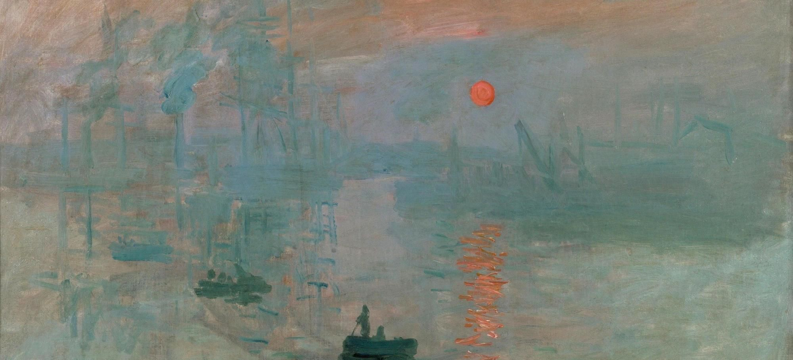
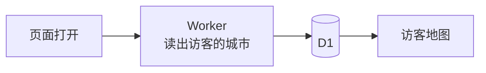
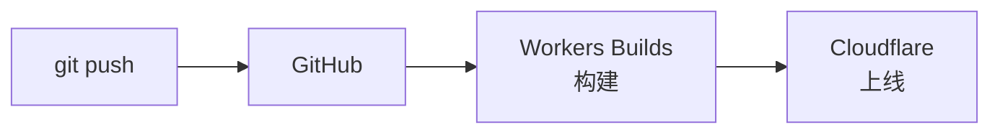

我的旧主页是一个 Jekyll 的学术模板，挂在 GitHub Pages 上。它能用，但我每次想加点自己的东西，都得先去读别人写的模板。

所以这次我把它整个推倒重来了。新站没有服务器，却住着一只会聊天的猫，有一个能拖着转的地球仪，页面最底下还有一张访客地图。整个过程是和 Claude Code 一起完成的：我说想要什么、在方案之间做选择，它写代码、跑验证。

这篇文章把这个站拆开讲一遍：用了什么，为什么这么选，哪里踩了坑。

## 先看全貌


说穿了只有三样东西：一堆静态文件、两个接口、两个存储桶。

网站的主体是纯静态的。构建时生成一批 HTML、CSS 和 JS，访客拿到的就是这些文件，中间没有任何程序在运行。只有 `/api/` 开头的两个地址会执行代码，用来记访客日志。照片和模型权重这类大文件单独放在存储桶里，页面只引用它们的地址。

## 为什么是 Astro

个人主页有一个特点：九成的内容是不会动的文字。简介、论文列表、博客，写完就是写完了。

很多前端框架的默认做法，是把整个页面交给 JavaScript，在访客的浏览器里再渲染一遍。对一个以文字为主的站来说，这是让访客为用不上的东西付流量。Jekyll 倒是纯静态，但想在它的模板里加一点交互就很别扭。

[Astro](https://astro.build) 正好站在中间。它默认输出纯 HTML，一行 JavaScript 都不带；哪个部件需要交互，哪个部件才加载自己的脚本。这个站里没有 React，也没有 Vue。地球仪的代码只在 Misc 页加载，访客地图的代码要等你快滚到页面底部时才去取。你现在看到的流程图也一样：画图用的 Mermaid 库不小，只有带图的文章才会加载它。

另一个让我喜欢的地方是内容管理。论文和博客都是 Markdown 文件，每一类有一份字段约定：

```ts
const blog = defineCollection({
  loader: glob({ pattern: '**/*.{md,mdx}', base: './src/content/blog' }),
  schema: z.object({
    title: z.string(),
    date: z.coerce.date(),
    lang: z.enum(['en', 'zh']).default('en'),
    draft: z.boolean().default(false),
  }),
});
```

日期写错了，或者漏了标题，构建时直接报错，不会带着一个坏页面上线。加一篇论文就是加一个文件，首页的精选、论文页的列表、猫的知识库都会跟着更新。

## 配色：从一幅画里来



配色没有用现成的色板，而是从莫奈的《日出·印象》里取的。港口晨雾的青绿色是主色，太阳的那一点橙色是第二强调色，背景是偏暖的灰白，像没上色的画布。

<div class="swatches">
<span style="--c:#f5f5f0"><b>画布</b><code>#f5f5f0</code></span>
<span style="--c:#fbfbf8"><b>纸面</b><code>#fbfbf8</code></span>
<span style="--c:#1b2a2a"><b>墨色</b><code>#1b2a2a</code></span>
<span style="--c:#5d6b6a"><b>灰绿</b><code>#5d6b6a</code></span>
<span style="--c:#dce2df"><b>细线</b><code>#dce2df</code></span>
<span style="--c:#2f6260"><b>港口青</b><code>#2f6260</code></span>
<span style="--c:#dbe8e6"><b>浅青</b><code>#dbe8e6</code></span>
<span style="--c:#b9552c"><b>日出橙</b><code>#b9552c</code></span>
</div>

橙色用得很省。它只出现在少数地方：首页大标题里被强调的那几个词，经历里拉出去的分支和导师的名字，猫正在生成的回答，还有访客地图上的光点。一种颜色到处都是，就不再是强调了。

深色主题不是把浅色反过来，而是同一幅画的夜晚版本：

<div class="swatches">
<span style="--c:#0e1717"><b>夜色</b><code>#0e1717</code></span>
<span style="--c:#142121"><b>深面</b><code>#142121</code></span>
<span style="--c:#e4eae8"><b>字色</b><code>#e4eae8</code></span>
<span style="--c:#93a3a2"><b>灰绿</b><code>#93a3a2</code></span>
<span style="--c:#253433"><b>细线</b><code>#253433</code></span>
<span style="--c:#7fc3bd"><b>港口青</b><code>#7fc3bd</code></span>
<span style="--c:#183635"><b>深青</b><code>#183635</code></span>
<span style="--c:#f0926c"><b>日出橙</b><code>#f0926c</code></span>
</div>

还有五个更淡的颜色，只在首页标题的生成动画里用来给 token 上色，名字也都来自莫奈画里的东西：

<div class="swatches">
<span style="--c:#f3d4dc"><b>睡莲粉</b><code>#f3d4dc</code></span>
<span style="--c:#f1e7b8"><b>阳光黄</b><code>#f1e7b8</code></span>
<span style="--c:#cfe7d2"><b>叶绿</b><code>#cfe7d2</code></span>
<span style="--c:#cfe0ef"><b>水蓝</b><code>#cfe0ef</code></span>
<span style="--c:#ddd6ef"><b>紫藤</b><code>#ddd6ef</code></span>
</div>

实现上很朴素：每个颜色是一个 CSS 变量，深色主题只是给同一批变量名换一套值，组件里永远只写 `var(--accent)`。每个页面的顶部还有一幅会渐渐融进背景的莫奈：论文页是《日出·印象》，博客是《睡莲》，照片页是《撑阳伞的女人》，Misc 是那座日本桥。

## 字体

<div class="specimen">
<p style="font-family:var(--serif);font-size:1.7rem"><small>Newsreader · 标题和英文长文</small>Building code agents for <em>the real world.</em></p>
<p style="font-family:var(--sans);font-size:1.05rem"><small>Inter + 系统中文字体 · 界面和中文正文</small>Research Engineer，正在做基于大模型的代码智能体。</p>
<p style="font-family:var(--mono);font-size:0.9rem"><small>系统等宽字体 · 代码、日期和数字</small>$ git log --graph career　　scholar.open()　　Sep 2026</p>
</div>

一共三种角色。

**标题和英文长文用 [Newsreader](https://fonts.google.com/specimen/Newsreader)**，一款为屏幕上长时间阅读设计的衬线体。它是可变字体，带一条“光学尺寸”轴：字号大的时候笔画对比更强、更精致，字号小的时候更结实、更好认。同一个字体文件，大标题和正文各用各的样子。

**界面和中文正文用 [Inter](https://rsms.me/inter/)**，加上系统自带的中文字体。我没有让访客下载中文字体：一套中文字体动辄几 MB，而苹方、微软雅黑、思源黑体已经在大家的设备里了。

**代码、日期和数字用系统的等宽字体**，同样不用下载。

Newsreader 和 Inter 是随网站一起托管的，不走 Google Fonts。最常用的三个字体文件会在页面开头预加载，尽量避免文字先用别的字体显示一下、再跳成最终的样子。

中英文文章的排版也不一样。英文用衬线体，行高 1.7；中文换成无衬线体，行高拉到 1.9，两端对齐，并且不允许标点出现在行首：

```css
.prose:lang(zh) {
  font-family: var(--sans);
  line-height: 1.9;
  text-align: justify;
  line-break: strict;
}
```

还有第四种字体藏在 Misc 页：成就面板用的像素字体 Pixelify Sans，只有 12 KB，只在那一页加载。面板上的等级数字是个例外，用的是等宽字体，因为像素字体里的 5 太像 S 了。

## 首页的几个小心思

**大标题是“生成”出来的。** 首页的标题会像语言模型解码一样，一个 token 一个 token 地出现：还没生成的部分是形状相同的噪声，旁边的小图表画着“下一个 token 的概率分布”，每一步从里面采样一根柱子。真正的文字其实一直都在 HTML 里，噪声只是盖在上面，所以搜索引擎读得到，关掉动画的人看得到，版面也不会抖。

**链接写成了工具调用。** 首页上的 Google Scholar、GitHub 这些链接，写的是 `scholar.open()`、`github.pull()`。做智能体的人大概会会心一笑。

**经历画成了 `git log --graph`。** 主线是一条提交记录，实习是旁边拉出去的分支，结束了就合并回主线。

## 角落里的猫

右下角那只 Pop Cat 是一个真的语言模型：Qwen3.5 0.8B，通过 [WebLLM](https://webllm.mlc.ai) 跑在你自己的浏览器里，用的是你的显卡（WebGPU）。背后没有推理服务器，也没有 API key。

这里面有几个值得一说的细节。

**权重只在你第一次提问时下载。** 大约 430 MB，下完就留在浏览器缓存里。模型跑在一个后台线程里，它思考的时候页面不会卡。

**权重放在我自己的 R2 存储桶里。** 默认的下载地址是 Hugging Face，在中国大陆打不开。R2 还有一个好处：下载流量不收费，对一个 430 MB 的文件来说这很重要。

**猫的知识不是手写的。** 构建时有一个脚本把站里的经历、论文和成就拼成一份资料交给它。我改了经历，猫也跟着改口。

**小模型不太听话。** 我想让它每句话都以“喵”结尾，0.8B 的模型做不到始终如一。最后的办法很直接：不指望它，等它写完，再由代码把每句话改成以“喵”结尾。同样的道理，用中文提问时，“请用中文回答”这句话要在问题的前后各说一遍，因为小模型倾向于用它最先和最后读到的语言回答。

## 地球仪

Misc 页有一个地球仪，标着我去过的地方。

第一版用的是一个点阵风格的库，把海岸线画成一个个小圆点。远看很酷，一放大就糊了。后来改成自己在 canvas 上画：用 [d3-geo](https://d3js.org/d3-geo) 做正交投影，用 [Natural Earth](https://www.naturalearthdata.com) 的矢量数据画海岸线和国界。矢量数据的好处是放大多少倍都清楚，整份世界地图也只有一百来 KB。

地点的名字需要互相避让。规则很简单：名字默认写在点的右边，右边被占了就写到左边，两边都放不下就只画点，等你放大了再显示。

改写的过程中出过两个有意思的问题。

第一个：有一阵子，地球仪是一个没有陆地的纯色圆盘。原因是脚本从 CSS 变量里读颜色，而页面上还留着旧版本的变量名，新的那几个根本没有定义。给 canvas 设一个空的颜色值不会报错，它只是默默沿用上一次的颜色，于是陆地、海洋和线条全成了同一个颜色。

第二个：放大四次再缩小四次，“缩小”按钮没有变灰。因为每次缩放乘以 1.6 或除以 1.6，浮点数算一圈回来不是整整的 1，而是比 1 大一点点。

## 访客地图和日志

首页最下面的访客地图，是这个站唯一用到“后端”的地方。



后端是一个两百来行的 [Cloudflare Worker](https://developers.cloudflare.com/workers/)，加一个 D1 数据库（跑在 Cloudflare 上的 SQLite）。页面打开时用 `sendBeacon` 向 `/api/log` 报告一次；Cloudflare 会在请求上附带访客所在的城市（`request.cf`），Worker 读出来写进数据库就行了，不需要任何第三方的统计脚本。首页的地图再从另一个接口把这些城市取回来。

我给自己定了几条规矩：不存 IP，不设 Cookie，位置只精确到城市。同一次访问里的几个页面，用一个只在当前标签页里有效的随机编号串起来，关掉标签页它就消失了。

Pop Cat 收到的问题和它的回答也会被记录，这样我能知道大家都在问什么。聊天框里写明了这一点：模型确实在你本地运行，但提问会被记下来，这件事应该让你知道。

还有一个配置上的小细节。Worker 只接管 `/api/*`，其他地址直接返回静态文件，根本不会启动它：

```jsonc
"assets": {
  "directory": "./dist",
  "binding": "ASSETS",
  "run_worker_first": ["/api/*"]
}
```

### 一次不太成功的限流

接口公开在网上，就得防着有人刷。我用了 Cloudflare 自带的限流，设成每个访客每分钟 60 次，然后老老实实测了一下。

结果是：一口气并发 150 个请求，全部通过；接着持续发了半分钟共 300 个，只有 8 个被拒绝。原因是 Cloudflare 的每台机器各自计数，这个限流本来就是“大致如此”的。

我本来想在上面再叠一层更严格的限制，后来换了个思路。一个个人主页被刷，最坏的结果不过是当天的日志记满。于是现在是这样：Worker 每天检查一次数据库，如果占用超过八成，或者一天内写入的日志多得不正常，就给我发一封邮件，我再去导出和清理。够用，也更好维护。

## 部署



代码放在 [GitHub](https://github.com/jwj1342/jwj1342.github.io) 上。推送到 `master` 之后，Cloudflare 自己拉代码、构建、发布，大约一分钟上线。写完这篇文章，我要做的也只是一次 `git push`。

旧地址 `jwj1342.github.io` 还能用。GitHub Pages 不支持配置 301 跳转，所以我让它只发布一个很小的分支，里面只有两个页面，作用是把访客带到 wenjia.me 的同一个路径：

```html
<script>
  location.replace('https://wenjia.me' + location.pathname + location.search + location.hash);
</script>
```

其中一个页面是 `404.html`，这是整个办法的关键。旧站的任何地址在新分支里都不存在，于是都会落到 404 页上，再被带到新站。到了新站以后，旧的论文链接由一份跳转表对应到新的页面。

## 零碎

还有几件小事，单独成不了一节，但都花过时间：

- **论文旁边的 star 数和引用数**是构建时从 GitHub 和 OpenAlex 取的，页面打开后会在浏览器里再刷新一次。GitHub 的匿名接口每小时只让查 60 次，所以取不到时会退回上一次存下来的数字。
- **老手机上的样式。** 构建工具默认会把媒体查询改写成一种更新的语法，16.4 之前的 Safari 不认识，会直接忽略整条规则。解决办法是告诉构建工具，输出的 CSS 要让老浏览器也能读懂。
- **照片不进 Git。** 加照片是一条命令：脚本生成缩略图和大图，去掉照片里的位置信息，上传到 R2，再把尺寸和主色调记进一个 JSON 文件。主色调用来在图片加载出来之前先垫一块颜色。
- **成就面板的背景**不是图片，是用一个固定的随机数种子在构建时算出来的像素纹理，所以每次构建都一模一样。

## 用到的东西

- **[Astro](https://astro.build)**：静态站点框架，默认不输出 JavaScript。整个站的骨架。
- **TypeScript**：带类型的 JavaScript。页面脚本和那个 Worker 都用它写。
- **[KaTeX](https://katex.org) 和 [Shiki](https://shiki.style)**：前者排数学公式，后者给代码上色，都在构建时完成，浏览器里不用再算。
- **[Mermaid](https://mermaid.js.org)**：用几行文字描述流程图，这篇文章里的图就是它画的。
- **[d3-geo](https://d3js.org/d3-geo) 和 [Natural Earth](https://www.naturalearthdata.com)**：地图投影的数学，和一份公共领域的世界地图数据。地球仪和访客地图都靠它们。
- **[WebLLM](https://webllm.mlc.ai) 和 WebGPU**：让语言模型直接跑在浏览器里，用访客自己的显卡。
- **[PhotoSwipe](https://photoswipe.com)**：照片墙点开后的大图浏览。
- **Cloudflare Workers**：托管静态文件，顺便运行那两个接口。
- **Cloudflare D1**：跑在边缘的 SQLite，存访客日志。
- **Cloudflare R2**：对象存储，放照片和模型权重，下载流量不收费。
- **Workers Builds**：推送代码后自动构建和发布。
- **Workers AI**：站里有一个翻译脚本，用它把博客翻成另一种语言。

源码都在 [GitHub](https://github.com/jwj1342/jwj1342.github.io) 上，想看哪一部分是怎么写的可以直接去翻。右下角的猫也可以回答关于我的问题，不过它只是个 0.8B 的小模型，说错了别太当真。
