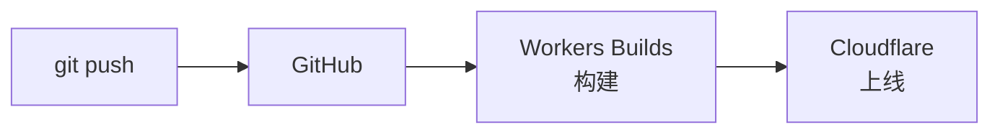
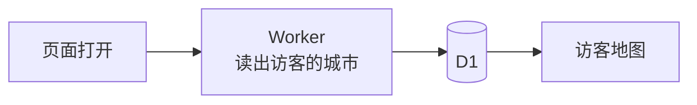

我的旧主页是一个 Jekyll 的学术模板，挂在 GitHub Pages 上。它能用，但我每次想加点自己的东西，都得先去读别人写的模板。

所以这次我把它整个推倒重来了。新站没有自己的服务器，却住着一只会聊天的猫，有一个能拖着转的地球仪，页面最底下还有一张访客地图。整个过程是和 Claude Code 一起完成的，我负责说想要什么、在方案之间做选择，它负责写代码和跑验证。

这篇文章把这个站拆开讲一遍，包括用了什么、为什么这么选，以及哪里踩了坑。篇幅不短，可以挑感兴趣的部分看。

## 先看全貌


整个站可以归结为三样东西，一堆静态文件、两个接口和两个存储桶。

网站的主体是纯静态的。构建时生成一批 HTML、CSS 和 JS，访客拿到的就是这些文件，中间没有任何程序在运行。只有 `/api/` 开头的两个地址会执行代码，一个用来记访客日志，一个给访客地图提供数据。照片和模型权重这类大文件单独放在存储桶里，页面只引用它们的地址。

## 为什么是 Astro

个人主页有一个特点，九成的内容是不会动的文字。简介、论文列表、博客，写完就是写完了。

很多前端框架默认把整个页面交给 JavaScript，在访客的浏览器里再渲染一遍。对一个以文字为主的站来说，这等于让访客为用不上的东西付流量。Jekyll 倒是纯静态，但想在它的模板里加一点交互就很别扭。

[Astro](https://astro.build) 正好站在中间。它默认输出纯 HTML，一行 JavaScript 都不带，哪个部件需要交互，哪个部件才加载自己的脚本。这个站里没有 React，也没有 Vue。地球仪的代码只在 Misc 页加载，访客地图的代码要等你快滚到页面底部时才去取。你现在看到的流程图也是这样，画图用的 Mermaid 库不小，只有带图的文章才会加载它。

另一个让我喜欢的地方是内容管理。论文和博客都是 Markdown 文件，每一类有一份字段约定，下面是博客的那一份。

```ts
const blog = defineCollection({
  loader: glob({ pattern: '**/*.{md,mdx}', base: './src/content/blog' }),
  schema: z.object({
    title: z.string(),
    date: z.coerce.date(),
    lang: z.enum(['en', 'zh']).default('en'),
    draft: z.boolean().default(false),
  }),
});
```

日期写错了，或者漏了标题，构建时直接报错，不会带着一个坏页面上线。加一篇论文就是加一个文件，首页的精选、论文页的列表、猫的知识库都会跟着更新。

Astro 还顺手做了图片优化。页面里的图片在构建时被转成 WebP，并按几种宽度各生成一份，浏览器会按屏幕大小挑合适的那一张。

## 从一幅画里来的配色


配色没有用现成的色板，是从莫奈的《日出·印象》里取的。港口晨雾的青绿色是主色，太阳的那一点橙色是第二强调色，背景是偏暖的灰白，像没上色的画布。

<div class="swatches">
<span style="--c:#f5f5f0"><b>画布</b><code>#f5f5f0</code></span>
<span style="--c:#fbfbf8"><b>纸面</b><code>#fbfbf8</code></span>
<span style="--c:#1b2a2a"><b>墨色</b><code>#1b2a2a</code></span>
<span style="--c:#5d6b6a"><b>灰绿</b><code>#5d6b6a</code></span>
<span style="--c:#dce2df"><b>细线</b><code>#dce2df</code></span>
<span style="--c:#2f6260"><b>港口青</b><code>#2f6260</code></span>
<span style="--c:#dbe8e6"><b>浅青</b><code>#dbe8e6</code></span>
<span style="--c:#b9552c"><b>日出橙</b><code>#b9552c</code></span>
</div>

橙色用得很省，只出现在少数几处，包括首页大标题里被强调的那几个词、经历里拉出去的分支和导师的名字、猫正在生成的回答，还有访客地图上的光点。一种颜色如果到处都是，就不再是强调了。

深色主题没有简单地把浅色反过来，我把它当成同一幅画的夜晚版本来调。

<div class="swatches">
<span style="--c:#0e1717"><b>夜色</b><code>#0e1717</code></span>
<span style="--c:#142121"><b>深面</b><code>#142121</code></span>
<span style="--c:#e4eae8"><b>字色</b><code>#e4eae8</code></span>
<span style="--c:#93a3a2"><b>灰绿</b><code>#93a3a2</code></span>
<span style="--c:#253433"><b>细线</b><code>#253433</code></span>
<span style="--c:#7fc3bd"><b>港口青</b><code>#7fc3bd</code></span>
<span style="--c:#183635"><b>深青</b><code>#183635</code></span>
<span style="--c:#f0926c"><b>日出橙</b><code>#f0926c</code></span>
</div>

另外还有五个更淡的颜色，只在首页标题的生成动画里用来给 token 上色，名字也都来自莫奈画里的东西。

<div class="swatches">
<span style="--c:#f3d4dc"><b>睡莲粉</b><code>#f3d4dc</code></span>
<span style="--c:#f1e7b8"><b>阳光黄</b><code>#f1e7b8</code></span>
<span style="--c:#cfe7d2"><b>叶绿</b><code>#cfe7d2</code></span>
<span style="--c:#cfe0ef"><b>水蓝</b><code>#cfe0ef</code></span>
<span style="--c:#ddd6ef"><b>紫藤</b><code>#ddd6ef</code></span>
</div>

实现上很朴素。每个颜色是一个 CSS 变量，深色主题只是给同一批变量名换一套值，组件里永远只写 `var(--accent)`。如果你手动切换过主题，这个选择会记在浏览器里，下次打开时在页面画出来之前就先应用上，不会先闪一下浅色。

每个页面的顶部还有一幅渐渐融进背景的莫奈，论文页是《日出·印象》，博客是《睡莲》，照片页是《撑阳伞的女人》，Misc 是那座日本桥。

## 字体

<div class="specimen">
<p style="font-family:var(--serif);font-size:1.7rem"><small>Newsreader，用于标题和英文长文</small>Building code agents for <em>the real world.</em></p>
<p style="font-family:var(--sans);font-size:1.05rem"><small>Inter 加系统中文字体，用于界面和中文正文</small>Research Engineer，正在做基于大模型的代码智能体。</p>
<p style="font-family:var(--mono);font-size:0.9rem"><small>系统等宽字体，用于代码、日期和数字</small>$ git log --graph career　　scholar.open()　　Sep 2026</p>
</div>

站里的字体分三种角色。

标题和英文长文用 [Newsreader](https://fonts.google.com/specimen/Newsreader)，这是一款为屏幕上长时间阅读设计的衬线体。它是可变字体，带一条光学尺寸轴，字号大的时候笔画对比更强、更精致，字号小的时候更结实、更好认。同一个字体文件，大标题和正文各用各的样子。

界面和中文正文用 [Inter](https://rsms.me/inter/)，再加上系统自带的中文字体。我没有让访客下载中文字体，因为一套中文字体动辄几 MB，而苹方、微软雅黑和思源黑体已经在大家的设备里了。代码、日期和数字用系统的等宽字体，同样不用下载。

Newsreader 和 Inter 通过 Fontsource 的 npm 包随网站一起托管，不经过 Google Fonts。最常用的三个字体文件会在页面开头预加载，尽量避免文字先用别的字体显示一下、再跳成最终的样子。

中英文文章的排版也不一样。英文用衬线体，行高 1.7。中文换成无衬线体，行高拉到 1.9，两端对齐，并且不让标点出现在行首。

```css
.prose:lang(zh) {
  font-family: var(--sans);
  line-height: 1.9;
  text-align: justify;
  line-break: strict;
}
```

还有第四种字体藏在 Misc 页。成就面板用的是像素字体 Pixelify Sans，只有 12 KB，只在那一页加载。面板上的等级数字是个例外，用的是等宽字体，因为像素字体里的 5 太像 S 了。

## 首页的几个小心思

首页的大标题是一点一点生成出来的。它模仿语言模型解码的样子，一个 token 一个 token 地出现，还没生成的部分显示成形状相同的噪声，旁边的小图表画着下一个 token 的概率分布，每一步从里面采样一根柱子。真正的文字其实一直都在 HTML 里，噪声只是盖在上面，所以搜索引擎读得到，关掉动画的人看得到，版面也不会抖。

首页上的几个外链写成了工具调用的样子，Google Scholar 是 `scholar.open()`，GitHub 是 `github.pull()`。做智能体的人大概会会心一笑。

经历那一节画成了 `git log --graph`。主线是一条提交记录，实习是旁边拉出去的分支，结束了就合并回主线。

## 屏幕底端的猫

屏幕底端那只 Pop Cat 是一个真的语言模型。它是 Qwen3.5 0.8B，通过 [WebLLM](https://webllm.mlc.ai) 跑在你自己的浏览器里，用的是你的显卡，也就是 WebGPU。背后没有推理服务器，也没有 API key。

权重只在你第一次提问时下载，大约 430 MB，下完就留在浏览器缓存里。模型跑在一个后台线程里，它思考的时候页面不会卡。

权重放在我自己的 R2 存储桶里。WebLLM 默认从 Hugging Face 下载，而那个地址在中国大陆打不开。R2 还有一个好处是下载流量不收费，对一个 430 MB 的文件来说这很重要。

猫知道的关于我的事情不是手写的。构建时有一个脚本把站里的经历、论文和成就拼成一份资料交给它，我改了经历，猫也跟着改口。

小模型不太听话。我想让它每句话都以喵结尾，0.8B 的模型做不到始终如一。最后的办法很直接，不指望它，等它写完，再由代码把每句话改成以喵结尾。语言也是类似的情况。用中文提问时，要求它用中文回答的那句话得在问题的前后各说一遍，因为小模型倾向于用它最先和最后读到的语言回答。

## 地球仪

Misc 页有一个地球仪，标着我去过的地方。

第一版用的是一个点阵风格的库，把海岸线画成一个个小圆点。远看很酷，一放大就糊了。后来改成自己在 canvas 上画，用 [d3-geo](https://d3js.org/d3-geo) 做正交投影，用 [Natural Earth](https://www.naturalearthdata.com) 的矢量数据画海岸线和国界。矢量数据放大多少倍都清楚，整份世界地图也只有一百来 KB。

地点的名字需要互相避让。名字默认写在点的右边，右边被占了就写到左边，两边都放不下就只画点，等你放大了再显示。

改写的过程中出过两个有意思的问题。

有一阵子，地球仪是一个没有陆地的纯色圆盘。脚本从 CSS 变量里读颜色，而页面上还留着旧版本的变量名，新的那几个根本没有定义。给 canvas 设一个空的颜色值不会报错，它只是默默沿用上一次的颜色，于是陆地、海洋和线条全成了同一个颜色。

另一个问题出在缩放上。放大四次再缩小四次，缩小按钮没有变灰。每次缩放是乘以或除以 1.6，浮点数算一圈回来不是整整的 1，而是比 1 大一点点，程序就以为还能继续缩小。

## 为什么搬到 Cloudflare，而不是留在 GitHub Pages

旧站一直放在 GitHub Pages 上。它免费、省心，推送就上线。新站没有留在那里，是因为它要做的事超出了 GitHub Pages 的范围。

GitHub Pages 只做一件事，把仓库里的文件原样发给访客。它不能运行服务端代码，所以访客日志的接口没处放，数据库更无从谈起。它对体积也有限制，一个站点不能超过 1 GB，仓库里超过 100 MiB 的文件会被直接拒收，而猫的模型权重有 430 MB，照片也会越攒越多。它还不让你配置响应头和跳转，后面会看到，连把旧地址 301 到新地址这种小事都做不到。

当然可以把这些东西分散到几家服务上，静态页面留在 GitHub，接口找一家云函数，文件再找一家对象存储。我不想维护三套账号和三种部署方式。Cloudflare 把这几样放在了一起，而且每一样都有免费额度，这个站的用量离这些额度的上限都还很远。

下面是这个站用到的 Cloudflare 部件。

| 部件 | 在这个站里做什么 | 免费额度 |
| --- | --- | --- |
| Workers 静态资源 | 托管构建出来的所有页面文件 | 请求免费且不限量，一个版本最多 20,000 个文件，单个文件最大 25 MiB |
| Workers | 运行 `/api` 下的两个接口 | 每天 10 万次请求，每次请求 10 毫秒 CPU 时间 |
| D1 | 存访客日志和访客地图的数据 | 单个数据库 500 MB，每天读 500 万行、写 10 万行 |
| R2 | 存照片和模型权重 | 每月 10 GB 存储，下载流量不收费 |
| Workers Builds | 推送代码后自动构建和发布 | 每月 3,000 分钟构建时间 |
| Rate Limiting | 给接口限流 | 随 Workers 一起使用 |
| Cron Triggers | 每天定时检查一次数据库 | 每个账号 5 个定时任务 |
| Email Service | 数据库需要处理时给我发邮件 | 发给自己验证过的邮箱不计费 |
| Workers AI | 翻译博客，只在我本机运行脚本时调用 | 每天 10,000 Neurons |

表里的前两行值得多说几句，因为它们其实是同一个 Worker 的两面。一个 Worker 可以带一批静态文件，也可以带一段代码。对静态文件的请求免费而且不限量，根本不会启动那段代码。只有我在配置里点名的 `/api/*` 才会交给代码处理，这部分请求算在每天十万次的额度里。对一个个人主页来说，这意味着页面被访问多少次都不花钱，需要留意的只有日志接口。

D1 是跑在 Cloudflare 上的 SQLite。它没有连接串和端口这些概念，在 Worker 里拿到的就是一个可以直接执行 SQL 的对象。表结构写在仓库的 `migrations/` 目录里，用一条命令应用到线上。

R2 是对象存储，接口和 S3 兼容。我开了两个桶，一个放照片，一个放模型权重，各绑了一个子域名。它和别家最大的区别是下载流量不收费，只按存储量和操作次数计费。

剩下几项都是小零件。Workers Builds 负责在推送之后自动构建和发布，Cron Triggers 每天叫醒 Worker 一次去检查数据库，Email Service 让 Worker 能给我发提醒邮件，Workers AI 只在我本机运行翻译脚本时才会被调用。

GitHub 并没有退场。代码仍然放在 GitHub 上，推送仍然是发布的起点，旧地址的跳转页也还由 GitHub Pages 发布。它只是从托管网站的地方，变成了存代码和触发构建的地方。

## wrangler，以及为什么不用 GitHub Actions 部署

Cloudflare 这边的一切都通过 wrangler 来操作。它是 Cloudflare 官方的命令行工具，这个项目里凡是和 Cloudflare 打交道的事都经过它。

所有部件的接线写在同一个配置文件里，Worker 的入口、静态文件目录、数据库、限流、定时任务和邮件各占几行。下面是节选。

```jsonc
{
  "name": "wenjia-me",
  "routes": [{ "pattern": "wenjia.me", "custom_domain": true }],
  "main": "worker/index.ts",
  "assets": {
    "directory": "./dist",
    "binding": "ASSETS",
    "run_worker_first": ["/api/*"]
  },
  "d1_databases": [{ "binding": "DB", "database_name": "wenjia-me", "database_id": "..." }],
  "ratelimits": [{ "name": "API_LIMIT", "namespace_id": "1001", "simple": { "limit": 60, "period": 60 } }],
  "triggers": { "crons": ["0 1 * * *"] },
  "send_email": [{ "name": "EMAIL" }]
}
```

`run_worker_first` 那一行就是前面说的点名。除了它列出的路径，其他地址都直接返回静态文件。

日常用到的命令不多。`wrangler dev` 在本机把整个站跑起来，数据库、限流器和发邮件都有本地的模拟版本，接口可以先在自己电脑上测通。`wrangler deploy` 把构建结果和 Worker 一起发布。`wrangler d1 migrations apply` 更新表结构，`wrangler d1 execute` 直接对线上数据库执行 SQL，我看日志用的就是它。加照片的脚本内部调用的是 `wrangler r2 object put`。

自动部署有两条路可以选。一条是 GitHub Actions，在仓库里写一个工作流，每次推送后由 GitHub 的机器构建，再调用 wrangler 发布。这样做需要先在 Cloudflare 生成一个 API token，存进 GitHub 的密钥里，还要维护那份工作流文件。另一条是 Cloudflare 自己的 Workers Builds，在后台把 Worker 和 GitHub 仓库连起来，之后每次推送，Cloudflare 自己拉代码，运行 `npm run build`，再运行 `npx wrangler deploy`。

我选了后者。它不需要把任何密钥放到 Cloudflare 之外，仓库里也不用多一份工作流文件，构建日志就在 Worker 的页面上。它运行的命令和我在本机手动发布时敲的完全一样，出了问题很容易在本机复现。



从推送到上线大约一分钟。写完这篇文章，我要做的也只是一次 `git push`。

旧地址 `jwj1342.github.io` 还能用，这要归功于一个小技巧。GitHub Pages 不支持配置 301 跳转，所以我让它只发布一个很小的分支，里面只有两个页面，作用是把访客带到 wenjia.me 的同一个路径。

```html
<script>
  location.replace('https://wenjia.me' + location.pathname + location.search + location.hash);
</script>
```

其中一个页面是 `404.html`，这是整个办法的关键。旧站的任何地址在新分支里都不存在，于是都会落到 404 页上，再被带到新站。到了新站以后，旧的论文链接由一份跳转表对应到新的页面，这份表正是 Cloudflare 支持而 GitHub Pages 不支持的那种配置。

## 访客地图和日志

首页最下面的访客地图，是这个站唯一用到后端的地方。



后端就是前面说的那个 Worker，两百来行。页面打开时用 `sendBeacon` 向 `/api/log` 报告一次。Cloudflare 会在每个请求上附带它对访客位置的判断，放在 `request.cf` 里，精确到城市。Worker 把城市读出来写进 D1 就行了，不需要任何第三方的统计脚本。首页的地图再从另一个接口把这些城市取回来，画成光点。

我给自己定了几条规矩。不存 IP，不设 Cookie，位置只精确到城市。同一次访问里的几个页面，用一个只在当前标签页里有效的随机编号串起来，关掉标签页它就消失了。

Pop Cat 收到的问题和它的回答也会被记录，这样我能知道大家都在问什么。聊天框里写明了这一点。模型确实在你本地运行，但提问会被记下来，这件事应该让你知道。

### 一次不太成功的限流

接口公开在网上，就得防着有人刷。Cloudflare 给 Worker 提供了一个限流器，我设成每个访客每分钟 60 次，然后老老实实测了一下。

一口气并发 150 个请求，全部通过。接着持续发了半分钟共 300 个，只有 8 个被拒绝。

回头去读文档才明白。文档里写得很清楚，这个限流是近似的，每个 Cloudflare 机房各自计数，计数在后台慢慢同步，请求数超过设定值是预期之内的事。真要一个严格的全局上限，文档建议用 Durable Objects 自己实现。

我本来想照着再叠一层严格的限制，后来换了个思路。一个个人主页被刷，最坏的结果不过是当天的日志额度用完，网站本身不受影响。于是现在的做法是，Worker 每天定时检查一次数据库，如果占用超过八成，或者一天内写入的日志多得不正常，就给我发一封邮件，我再去导出和清理。这样够用，也更好维护。

## 零碎

还有几件小事，单独成不了一节，但都花过时间。

论文旁边的 star 数和引用数是构建时从 GitHub 和 OpenAlex 取的，页面打开后还会在浏览器里再刷新一次。GitHub 的匿名接口每小时只让查 60 次，所以取不到的时候会退回上一次存下来的数字。

老手机上的样式出过问题。构建工具默认会把媒体查询改写成一种更新的语法，16.4 之前的 Safari 不认识，会直接忽略整条规则。解决办法是告诉构建工具，输出的 CSS 要让老浏览器也能读懂。

照片不进 Git。加照片是一条命令，脚本生成缩略图和大图，去掉照片里的位置信息，上传到 R2，再把尺寸和主色调记进一个 JSON 文件。主色调用来在图片加载出来之前先垫一块颜色。

成就面板的背景不是图片。它是用一个固定的随机数种子在构建时算出来的像素纹理，所以每次构建都一模一样。

## 写在最后

回头数一数，页面这一侧用到的是 Astro 和 TypeScript，公式和代码高亮靠 [KaTeX](https://katex.org) 和 [Shiki](https://shiki.style)，流程图是 [Mermaid](https://mermaid.js.org)，地图是 d3-geo 加 Natural Earth 的数据，照片墙的大图浏览用的是 [PhotoSwipe](https://photoswipe.com)，猫靠 WebLLM 和 WebGPU 跑起来。服务这一侧全部在 Cloudflare 上，前面那张表已经列全了。

源码都在 [GitHub](https://github.com/jwj1342/jwj1342.github.io) 上，想看哪一部分是怎么写的可以直接去翻。屏幕底端的猫也可以回答关于我的问题，不过它只是个 0.8B 的小模型，说错了别太当真。
