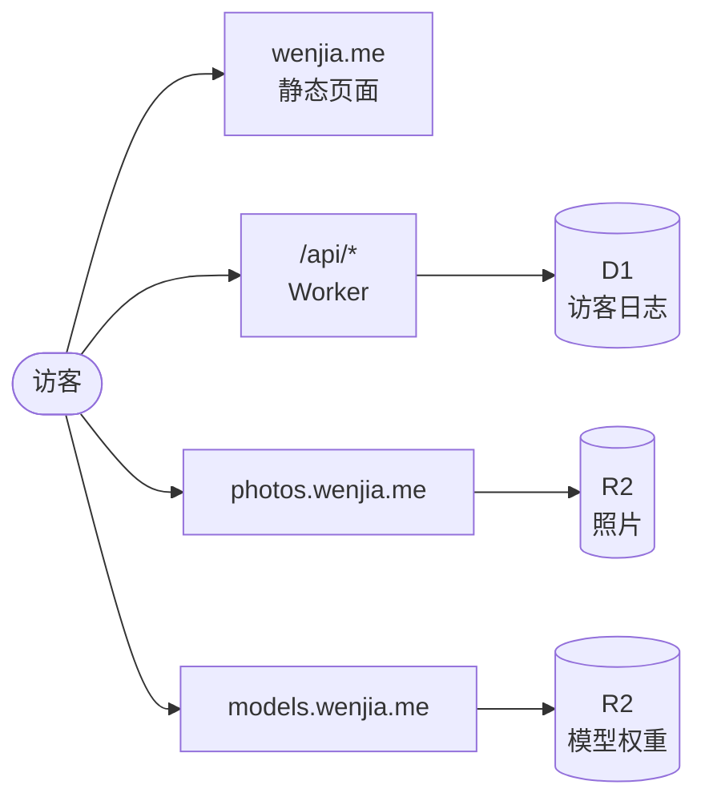
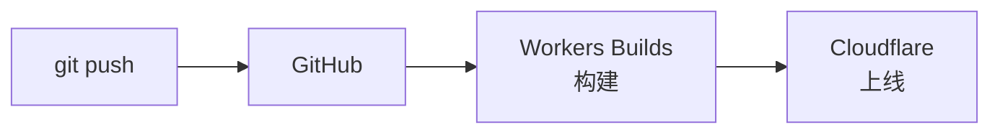
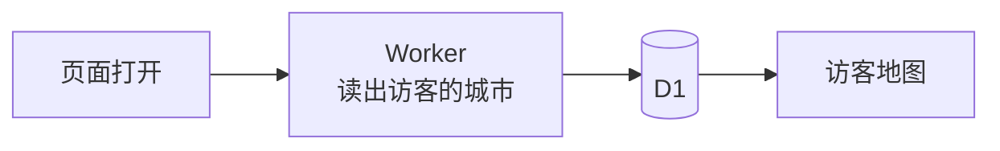

之前的主页一直套着一个 Jekyll 的学术模板，挂在 GitHub Pages 上。能用是能用，可每次想加点自己的东西，都得先去翻别人写的模板，改起来很别扭。

这次干脆整个推倒重来了。新站连一台自己的服务器都没有，我却往里面塞了不少好玩的东西。屏幕底端蹲着一只真能跑语言模型的猫，Misc 页有一个能拖着转的地球仪，首页最底下还有一张访客地图。整个过程基本是和 Claude Code 搭档完成的，我提需求、拍板选方案，它写代码、跑验证。

下面聊聊它是怎么搭起来的，为什么这么选，中间又踩了哪些坑。

## 先看全貌



说白了就三样东西，一堆静态文件、两个接口、两个存储桶。

页面全是构建时生成好的 HTML、CSS 和 JS，访客来了直接拿文件走人，中间没有任何程序在跑。真正会执行代码的只有 `/api/` 开头的两个地址，一个记访客日志，一个给访客地图喂数据。至于照片和模型权重这种大家伙，我把它们单独扔进了存储桶，页面里只留一个地址。

## 为什么是 Astro

想清楚一件事之后，选型就很简单了。个人主页九成的内容是不会动的文字，简介、论文列表、博客，写完就是写完了。

可很多前端框架偏偏默认把整个页面交给 JavaScript，到了访客的浏览器里再渲染一遍。一个以文字为主的站这么干，等于让访客为根本用不上的东西付流量。Jekyll 倒是纯静态，但我已经领教过在它的模板里加交互有多别扭了。

[Astro](https://astro.build) 正好卡在中间。它默认只吐纯 HTML，一行 JavaScript 都不带，哪个部件需要交互，哪个部件才加载自己的脚本。所以这个站里没有 React，也没有 Vue。地球仪的代码只在 Misc 页加载，访客地图的代码要等你快滚到页面底部才去取。连你现在看到的流程图也是这样，画图用的 Mermaid 库个头不小，只有带图的文章才会把它请进来。

内容管理也让我很舒服。论文和博客都是 Markdown 文件，每一类有一份字段约定，博客的长这样。

```ts
const blog = defineCollection({
  loader: glob({ pattern: '**/*.{md,mdx}', base: './src/content/blog' }),
  schema: z.object({
    title: z.string(),
    date: z.coerce.date(),
    lang: z.enum(['en', 'zh']).default('en'),
    draft: z.boolean().default(false),
  }),
});
```

哪天手滑把日期写错了，或者漏了标题，构建当场就报错，坏页面根本上不了线。加一篇论文也只是加一个文件，首页的精选、论文页的列表，连猫的知识库都会跟着更新。

图片优化则是白送的。构建时图片会被转成 WebP，还按几种宽度各出一份，浏览器自己挑合适的那张，我什么都不用管。

## 从一幅画里来的配色


我喜欢莫奈的画，所以配色没有去找现成的色板，直接从《日出·印象》里取。港口晨雾的那种青绿色做主色，太阳的那一点橙色做第二强调色，背景是偏暖的灰白，像一块还没上色的画布。

<div class="swatches">
<span style="--c:#f5f5f0"><b>画布</b><code>#f5f5f0</code></span>
<span style="--c:#fbfbf8"><b>纸面</b><code>#fbfbf8</code></span>
<span style="--c:#1b2a2a"><b>墨色</b><code>#1b2a2a</code></span>
<span style="--c:#5d6b6a"><b>灰绿</b><code>#5d6b6a</code></span>
<span style="--c:#dce2df"><b>细线</b><code>#dce2df</code></span>
<span style="--c:#2f6260"><b>港口青</b><code>#2f6260</code></span>
<span style="--c:#dbe8e6"><b>浅青</b><code>#dbe8e6</code></span>
<span style="--c:#b9552c"><b>日出橙</b><code>#b9552c</code></span>
</div>

橙色我用得很抠门，只在少数几处露面，比如首页大标题里被强调的那几个词、经历里拉出去的分支和导师的名字、猫正在生成的回答，还有访客地图上的光点。一种颜色要是到处都是，也就谈不上强调了。

深色主题我没有偷懒把浅色直接反过来，而是当成同一幅画的夜晚版本重新调了一遍。

<div class="swatches">
<span style="--c:#0e1717"><b>夜色</b><code>#0e1717</code></span>
<span style="--c:#142121"><b>深面</b><code>#142121</code></span>
<span style="--c:#e4eae8"><b>字色</b><code>#e4eae8</code></span>
<span style="--c:#93a3a2"><b>灰绿</b><code>#93a3a2</code></span>
<span style="--c:#253433"><b>细线</b><code>#253433</code></span>
<span style="--c:#7fc3bd"><b>港口青</b><code>#7fc3bd</code></span>
<span style="--c:#183635"><b>深青</b><code>#183635</code></span>
<span style="--c:#f0926c"><b>日出橙</b><code>#f0926c</code></span>
</div>

另外还有五个更淡的颜色，只在首页标题的生成动画里给 token 上色用。名字我也顺手从莫奈的画里取了。

<div class="swatches">
<span style="--c:#f3d4dc"><b>睡莲粉</b><code>#f3d4dc</code></span>
<span style="--c:#f1e7b8"><b>阳光黄</b><code>#f1e7b8</code></span>
<span style="--c:#cfe7d2"><b>叶绿</b><code>#cfe7d2</code></span>
<span style="--c:#cfe0ef"><b>水蓝</b><code>#cfe0ef</code></span>
<span style="--c:#ddd6ef"><b>紫藤</b><code>#ddd6ef</code></span>
</div>

实现起来倒是朴素得很。每个颜色是一个 CSS 变量，深色主题无非是给同一批变量名换一套值，组件里从头到尾只写 `var(--accent)`。你要是手动切过主题，选择会记在浏览器里，下次打开时页面还没画出来就先应用上，不会先闪一下浅色。

每个页面顶上还藏着一幅渐渐融进背景的莫奈。论文页是《日出·印象》，博客是《睡莲》，照片页是《撑阳伞的女人》，Misc 是那座日本桥。

## 字体

<div class="specimen">
<p style="font-family:var(--serif);font-size:1.7rem"><small>Newsreader，用于标题和英文长文</small>Building code agents for <em>the real world.</em></p>
<p style="font-family:var(--sans);font-size:1.05rem"><small>Inter 加系统中文字体，用于界面和中文正文</small>Research Engineer，正在做基于大模型的代码智能体。</p>
<p style="font-family:var(--mono);font-size:0.9rem"><small>系统等宽字体，用于代码、日期和数字</small>$ git log --graph career　　scholar.open()　　Sep 2026</p>
</div>

字体最后定下来三种角色。

标题和英文长文交给 [Newsreader](https://fonts.google.com/specimen/Newsreader)。我看中的是它带一条光学尺寸轴，同一个字体文件，放大了做标题笔画纤细精致，缩小了做正文又变得结实好认，不用为标题和正文各找一款。

界面和中文正文用 [Inter](https://rsms.me/inter/)，中文部分直接借用系统自带的字体。让访客为了看我的主页去下载几 MB 的中文字体，这事我做不出来，何况苹方、微软雅黑和思源黑体早就躺在大家的设备里了。代码、日期和数字用系统的等宽字体，同样一个字节都不用下载。

Newsreader 和 Inter 是通过 Fontsource 的 npm 包跟着网站一起托管的，没有走 Google Fonts。最常用的三个字体文件我让页面一开头就预加载，免得文字先用别的字体露个脸，再突然跳成最终的样子。

中英文文章的排版我也分开调了。英文用衬线体，行高 1.7 就够。中文换成无衬线体，行高得拉到 1.9 才不挤，再加上两端对齐，并且不许标点跑到行首。

```css
.prose:lang(zh) {
  font-family: var(--sans);
  line-height: 1.9;
  text-align: justify;
  line-break: strict;
}
```

其实还有第四种字体藏在 Misc 页，成就面板用的像素字体 Pixelify Sans，只有 12 KB，也只在那一页加载。不过面板上的等级数字我没敢用它，因为像素字体里的 5 长得实在太像 S 了。

## 首页的几个小心思

首页的大标题不是直接显示出来的，它是一点一点生成出来的。学的是语言模型解码的样子，一个 token 一个 token 往外蹦。还没生成的部分先显示成形状相同的噪声，旁边的小图表画着下一个 token 的概率分布，每走一步就从里面采样一根柱子。看着花哨，其实真正的文字一直老老实实待在 HTML 里，噪声只是盖在上面的一层。所以搜索引擎照样读得到，关掉动画的人照样看得到，版面也不会跟着抖。

几个外链我也没放过，全写成了工具调用的样子。Google Scholar 是 `scholar.open()`，GitHub 是 `github.pull()`。做智能体的朋友看到应该会笑。

经历那一节干脆画成了 `git log --graph`。主线是一条提交记录，实习是旁边拉出去的分支，干完了再合并回主线。

## 屏幕底端的猫

屏幕底端那只 Pop Cat 不是摆设，它是一个货真价实的语言模型。具体来说是 Qwen3.5 0.8B，通过 [WebLLM](https://webllm.mlc.ai) 跑在你自己的浏览器里，用的是你的显卡，也就是 WebGPU。它背后没有推理服务器，也没有 API key，我一分钱推理费都不用出。

当然不能一打开页面就让人下载模型。权重要等你问出第一个问题才开始下，大约 430 MB，下完就留在浏览器缓存里。模型跑在后台线程里，它埋头思考的时候页面不会卡。要是你的浏览器不支持 WebGPU，猫会在你打开聊天框的那一刻直说自己醒不过来，顺手把输入框关掉，不会等你点下去才卡住。

权重放在哪儿是个问题。WebLLM 默认从 Hugging Face 下载，可那个地址在中国大陆根本打不开。最后我把它镜像到了自己的 R2 存储桶里，R2 的下载流量又不收费，430 MB 的文件随便下。

猫知道的那些关于我的事，没有一句是我手写给它的。构建时有个脚本会把站里的经历、论文和成就拼成一份资料交给它，我这边改了经历，它那边自动跟着改口。

最好笑的是这只猫不太听话。我想让它每句话都以喵结尾，可 0.8B 的小模型记性实在有限，说着说着就忘了。讲道理讲不通，我就不讲了，等它把话写完，再用代码把每句话的结尾硬改成喵。语言也是同样的毛病。你用中文问它，它却可能用英文答，后来发现得把要求它用中文回答的那句话在问题前后各塞一遍才管用，因为小模型更愿意听它最先和最后读到的话。

## 地球仪

Misc 页有个地球仪，标着我去过的地方。

第一版直接用了一个点阵风格的库，海岸线是一个个小圆点拼出来的。远看挺酷，可一放大就糊成一片。于是推倒重画，自己在 canvas 上用 [d3-geo](https://d3js.org/d3-geo) 做正交投影，再用 [Natural Earth](https://www.naturalearthdata.com) 的矢量数据描海岸线和国界。矢量的好处是放大多少倍都不糊，而且整份世界地图才一百来 KB。

地名多了会打架，所以还得让它们互相让路。规则不复杂，名字先往点的右边写，右边被占了就换到左边，两边都没位置就只留一个点，等你放大了再把名字放出来。

重画的过程里有两个坑让我印象很深。

头一个坑是，重画完打开页面，地球仪成了一个没有陆地的纯色圆盘，控制台里干干净净，一条报错都没有。查了一圈才发现，脚本是从 CSS 变量里读颜色的，而页面上留着的还是旧版本的变量名，新的那几个压根没定义。偏偏 canvas 拿到一个空的颜色值不会报错，它只会默默沿用上一次的颜色，结果陆地、海洋和线条全刷成了同一个颜色。

第二个坑更隐蔽。放大四次再缩小四次，按理说回到了原样，缩小按钮却没有变灰。原因是每次缩放乘以或除以 1.6，浮点数兜一圈回来并不是整整的 1，而是比 1 多出那么一丁点，程序就一本正经地认为还能再缩。

## 照着 Minecraft 做的成就面板

Misc 页上花心思最多的，其实是那块人生成就面板。我喜欢玩 Minecraft，所以它是照着游戏里的进度界面做的。一条主线从上往下串起每个阶段，阶段里解锁的成就从旁边分叉出去，没解锁的是灰的，带秘密标记的干脆只显示三个问号。

这一部分有些源代码借鉴了好朋友 He Geng 的项目，在这里谢谢他。

像素风最怕糊。只要有一条边没落在整像素上，或者哪里多了一点圆角和渐变，味道立刻就不对了。所以整块面板只认一个单位，一个像素定为 3px，描边、高光和阴影、成就之间的连线，粗细全是它的整数倍。格子的立体感也不是贴图，是三层 box-shadow 叠出来的。最外面一圈深色描边，左上内侧一道亮边，右下内侧一道暗边，看上去就像一块凸起来的方块。

```css
.tile {
  box-shadow:
    0 0 0 var(--px) var(--outline),
    inset var(--px) var(--px) 0 rgba(255, 255, 255, 0.45),
    inset calc(-1 * var(--px)) calc(-1 * var(--px)) 0 rgba(0, 0, 0, 0.3);
}
```

图标是我们一格一格画出来的，没有用游戏里的任何素材。每个图标是一张 14 乘 14 的格子，在代码里就是 14 行字符串，一个字符代表一个像素，点号是透明，字母去调色板里查颜色。下面这把镐子，就是面板左上角的那个徽章。

```ts
pickaxe: [
  '..............',
  '...kkkkkkk....',
  '..kSSSSSSSk...',
  '.kSsskkkksSk..',
  '.kskk..kWksSk.',
  '..k...kWwkksk.',
  '.....kWwk..kk.',
  '....kWwk......',
  '...kWwk.......',
  '..kWwk........',
  '.kWwk.........',
  '.kwk..........',
  '..k...........',
  '..............',
],
```

调色板一共 14 个颜色，每种材质占一对字母，小写是暗面，大写是亮面。`w` 和 `W` 是木头，`s` 和 `S` 是石头和铁，`g` 和 `G` 是金子。想给图标换个颜色，改字母就行，画一个新图标也只是再填一张格子。构建的时候，这些字符串会被转成 SVG 里的一个个小方块，同一行里相邻的同色像素先合并成一个长方形，所以图标体积很小，放大多少倍边缘都是硬的。现在一共画了 13 个，有镐子、斧子、剑、书、宝石、星星这些。

面板的背景看着像一张泥土贴图，其实也不是图片。它是构建时用一个固定的随机数种子算出来的 12 乘 12 像素纹理，从六种土色里挑颜色，再平铺开来。种子是固定的，所以每次构建出来都分毫不差。

经验条也守着游戏的规矩。每解锁一个成就默认加 100 点经验，升到 2 级要 200 点，之后每升一级再多要 100 点，经验条被切成 18 格。面板上的字用的是前面提过的像素字体，只有等级和经验这些数字例外，原因也说过了，像素字体里的 5 太像 S。

还有一点和全站不一样。这块面板不跟着浅色深色主题变，它有自己固定的一套颜色，像嵌在页面里的一个小游戏窗口。

## 为什么搬到 Cloudflare，而不是留在 GitHub Pages

老实说 GitHub Pages 挺好的，免费、省心，推送就上线，旧站一直放在那里。问题是新站想做的事，它一样都接不住。

GitHub Pages 只干一件事，把仓库里的文件原样发给访客。它跑不了服务端代码，访客日志的接口就没处放，数据库更是想都别想。它对体积也卡得紧，一个站点不能超过 1 GB，仓库里超过 100 MiB 的文件直接拒收，而我光是猫的模型权重就有 430 MB，照片还会越攒越多。它甚至不让你配响应头和跳转，后面你会看到，连把旧地址 301 到新地址这种小事它都办不到。

当然也可以东拼西凑，页面留在 GitHub，接口找一家云函数，文件再找一家对象存储。可我实在不想为了一个个人主页去管三套账号、三种部署方式。Cloudflare 把这几样全放在了一处，每一样还都有免费额度，以这个站的用量，离哪一项的上限都还远得很。

用到的部件我列了张表。

| 部件 | 在这个站里做什么 | 免费额度 |
| --- | --- | --- |
| Workers 静态资源 | 托管构建出来的所有页面文件 | 请求免费且不限量，一个版本最多 20,000 个文件，单个文件最大 25 MiB |
| Workers | 运行 `/api` 下的两个接口 | 每天 10 万次请求，每次请求 10 毫秒 CPU 时间 |
| D1 | 存访客日志和访客地图的数据 | 单个数据库 500 MB，每天读 500 万行、写 10 万行 |
| R2 | 存照片和模型权重 | 每月 10 GB 存储，下载流量不收费 |
| Workers Builds | 推送代码后自动构建和发布 | 每月 3,000 分钟构建时间 |
| Rate Limiting | 给接口限流 | 随 Workers 一起使用 |
| Cron Triggers | 每天定时检查一次数据库 | 每个账号 5 个定时任务 |
| Email Service | 数据库需要处理时给我发邮件 | 发给自己验证过的邮箱不计费 |
| Workers AI | 翻译博客，只在我本机运行脚本时调用 | 每天 10,000 Neurons |

前两行其实是同一个 Worker 的两张面孔。一个 Worker 可以带一批静态文件，也可以带一段代码。访问静态文件免费而且不限量，压根不会惊动那段代码。只有我在配置里点了名的 `/api/*` 才会交给代码处理，也只有这部分请求才算进每天十万次的额度。换句话说，页面被看多少次都不花钱，我真正要盯着的只有日志接口。

D1 用起来很省事。它就是一个跑在 Cloudflare 上的 SQLite，没有连接串，没有端口，在 Worker 里拿到手的直接是一个能执行 SQL 的对象。表结构写在仓库的 `migrations/` 目录里，一条命令就能应用到线上。

R2 打动我的只有一点，下载流量不收费。它是和 S3 兼容的对象存储，只按存了多少和操作了多少次收钱。我开了两个桶，一个放照片，一个放模型权重，各绑了一个子域名。

剩下的都是小零件。Workers Builds 管推送之后的自动构建和发布，Cron Triggers 每天把 Worker 叫醒一次去看看数据库，Email Service 让 Worker 能给我发提醒邮件，Workers AI 只有我在本机跑翻译脚本的时候才会被叫到。

GitHub 也没有就此下岗。代码还在 GitHub 上，推送还是发布的起点，旧地址的跳转页也还是 GitHub Pages 在发。它只是从放网站的地方，变成了放代码和触发构建的地方。

## wrangler，以及为什么不用 GitHub Actions 部署

和 Cloudflare 打交道，从头到尾只用一个工具，就是它官方的命令行 wrangler。

我最喜欢的是所有接线都写在同一个配置文件里。Worker 的入口、静态文件目录、数据库、限流、定时任务、邮件，各占几行，一眼就能看完整个站的后端长什么样。下面是节选。

```jsonc
{
  "name": "wenjia-me",
  "routes": [{ "pattern": "wenjia.me", "custom_domain": true }],
  "main": "worker/index.ts",
  "assets": {
    "directory": "./dist",
    "binding": "ASSETS",
    "run_worker_first": ["/api/*"]
  },
  "d1_databases": [{ "binding": "DB", "database_name": "wenjia-me", "database_id": "..." }],
  "ratelimits": [{ "name": "API_LIMIT", "namespace_id": "1001", "simple": { "limit": 60, "period": 60 } }],
  "triggers": { "crons": ["0 1 * * *"] },
  "send_email": [{ "name": "EMAIL" }]
}
```

里面的 `run_worker_first` 就是前面说的点名，没被它点到的地址一律直接返回静态文件。

平时用得上的命令也就那么几条。`wrangler dev` 能在本机把整个站跑起来，数据库、限流器、发邮件都有本地的模拟版本，接口可以先在自己电脑上折腾明白再上线。`wrangler deploy` 负责把构建结果和 Worker 一起发布。改表结构用 `wrangler d1 migrations apply`，想直接对线上数据库跑 SQL 就用 `wrangler d1 execute`，我平时看日志靠的就是它。连加照片的脚本，里面调的也是 `wrangler r2 object put`。

自动部署有两条路可走。一条是 GitHub Actions，在仓库里写个工作流，每次推送后由 GitHub 的机器构建，再调 wrangler 发布。麻烦在于得先去 Cloudflare 生成一个 API token，再存进 GitHub 的密钥里，那份工作流文件以后也得一直养着。另一条是 Cloudflare 自家的 Workers Builds，在后台把 Worker 和 GitHub 仓库连上，此后每次推送，Cloudflare 自己拉代码、跑 `npm run build`、再跑 `npx wrangler deploy`。

我选了后一条，理由很实在。密钥不用出 Cloudflare 的门，仓库里不用多养一份工作流文件，构建日志就挂在 Worker 的页面上。更重要的是它跑的命令和我在本机手动发布时敲的一模一样，哪天出了问题，在自己电脑上就能复现。



从推送到上线一分钟左右。写完这篇文章，我要做的也只是敲一次 `git push`。

顺便说说旧地址。`jwj1342.github.io` 现在还能打开，靠的是一个小把戏。GitHub Pages 不支持 301 跳转，我就让它只发布一个很小的分支，里面只有两个页面，唯一的任务是把人送到 wenjia.me 的同一个路径。

```html
<script>
  location.replace('https://wenjia.me' + location.pathname + location.search + location.hash);
</script>
```

其中一个页面是 `404.html`，整个把戏的关键就在它身上。旧站的所有地址在新分支里都不存在，于是统统掉到 404 页，再被送去新站。到了新站，旧的论文链接会被一份跳转表接住，对应到新的页面。讽刺的是，这份跳转表正是 Cloudflare 能配而 GitHub Pages 不能配的东西。

## 访客地图和日志

首页最下面那张访客地图，是整个站唯一需要后端的地方。



后端就是前面那个 Worker，统共两百来行。页面一打开，就用 `sendBeacon` 向 `/api/log` 打个招呼。妙的是位置根本不用我自己去查，Cloudflare 会在每个请求上附带它对访客位置的判断，放在 `request.cf` 里，精确到城市。Worker 把城市读出来写进 D1 就完事了，一行第三方统计脚本都不用引。首页的地图再从另一个接口把这些城市取回来画成光点，用的还是地球仪那一套 d3-geo 和 Natural Earth 数据，只是把正交投影换成了平铺的 Natural Earth 投影。

记日志这件事我给自己立了几条规矩。不存 IP，不种 Cookie，位置只到城市为止。同一次访问里翻过的几个页面，靠一个只在当前标签页里有效的随机编号串起来，标签页一关它就没了。

Pop Cat 收到的问题和它的回答我也会记下来，因为我确实好奇大家都在问它什么。这一点聊天框里写明了。模型是在你本地跑的没错，可提问会被记录，这种事不该瞒着你。

### 一次不太成功的限流

接口既然挂在公网上，总得防着有人来刷。Cloudflare 正好给 Worker 配了个限流器，我顺手设成每个访客每分钟 60 次，然后自己动手刷了一把，想看看它拦不拦得住。

结果我直接看愣了。一口气并发 150 个请求，全部放行。不死心又持续发了半分钟，一共 300 个，最后只拦下来 8 个。这限流器该不会是个摆设吧。

回头翻文档才算破了案。人家白纸黑字写着，这个限流是近似的，每个 Cloudflare 机房各数各的，计数在后台慢慢同步，请求数超过设定值属于意料之中。真想要一个严格的全局上限，文档的建议是拿 Durable Objects 自己造一个。

我差点就真去造了，转念一想又觉得没必要。一个个人主页被人刷，最坏也就是当天的日志额度用光，网站本身毫发无损。所以最后的方案朴素得多，Worker 每天定时看一眼数据库，占用超过八成，或者一天之内写进来的日志多得离谱，就给我发封邮件，我再去导出和清理。够用，也好养活。

## 零碎

最后是几件不值得单开一节、却都费过一番工夫的小事。

论文旁边的 star 数和引用数是构建时从 GitHub 和 OpenAlex 抓的，页面打开后浏览器还会再刷新一次。麻烦在于 GitHub 的匿名接口每小时只让同一个 IP 查 60 次，而校园网或者会议 Wi-Fi 底下一大群人共用一个出口，很容易就被挤爆。所以浏览器取到的数字会在本地存一个小时，这期间不再重复去问，实在取不到就退回上一次存下来的数字。

老手机上的样式也坑过我一回。构建工具默认会把媒体查询改写成一种更新的语法，16.4 之前的 Safari 不认识，认不出来就干脆把整条规则扔掉。解决办法倒简单，告诉构建工具输出的 CSS 得让老浏览器也读得懂。

照片是不进 Git 的。加照片只要一条命令，脚本会生成缩略图和大图，抹掉照片里的位置信息，传到 R2，再把尺寸和主色调记进一个 JSON 文件。记主色调是为了在图片加载出来之前，先在它的位置垫一块颜色。

## 写在最后

就先写到这儿。代码都在 [GitHub](https://github.com/jwj1342/jwj1342.github.io) 上，好奇哪一块是怎么写的可以直接去翻。

至于屏幕底端那只猫，你可以问问它关于我的事。只是别忘了它才 0.8B，说错了多担待。
