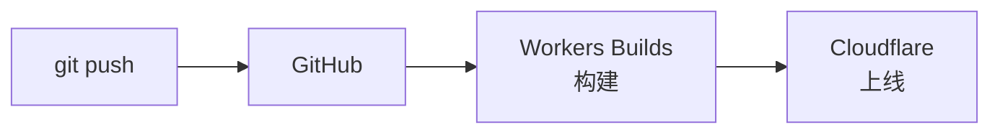
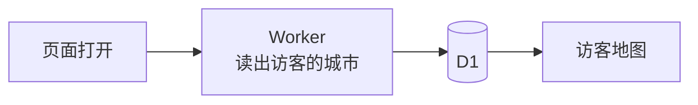

我之前的主页用的是一个 Jekyll 的学术模板，托管在 GitHub Pages 上。它能正常工作，但每次想加一点自己的东西，都要先读懂别人写的模板，改动的成本很高。

所以这次我把它整个重写了。新站没有自己的服务器，功能却比原来多了不少，屏幕底端有一只能运行语言模型的猫，Misc 页有一个可以拖动的地球仪，首页最下面还有一张访客地图。整个过程是和 Claude Code 一起完成的，我负责提出需求和在方案之间做选择，它负责写代码和验证。

这篇文章记录这个站的结构、每个选择背后的原因，以及过程中遇到的几个问题。

## 先看全貌


整个站由三部分组成，分别是静态文件、两个接口和两个存储桶。

网站的主体是静态的。页面在构建时就生成为 HTML、CSS 和 JS，访客拿到的就是这些文件，中间没有程序在运行。需要执行代码的只有 `/api/` 开头的两个地址，一个用来记录访客日志，另一个为访客地图提供数据。照片和模型权重的体积太大，不适合放进代码仓库，所以单独放在存储桶里，页面只引用它们的地址。

## 为什么是 Astro

选 Astro 的出发点是个人主页的内容特点。主页上九成的内容是不会变化的文字，比如简介、论文列表和博客，写完之后就不再需要任何运算。

很多前端框架默认把整个页面交给 JavaScript，在访客的浏览器里重新渲染一遍。对于以文字为主的网站，这意味着访客要为用不到的功能下载额外的代码。Jekyll 是纯静态的，没有这个问题，但在它的模板里加入交互并不方便，这也是我想离开它的原因之一。

[Astro](https://astro.build) 介于两者之间。它默认只输出 HTML，不带任何 JavaScript，只有需要交互的部件才会加载各自的脚本。因此这个站没有使用 React 或 Vue。地球仪的代码只在 Misc 页加载，访客地图的代码要等页面滚动到接近底部时才会请求。这篇文章里的流程图也是同样的做法，绘图用的 Mermaid 库体积不小，所以只有包含流程图的文章才会加载它。

选它的另一个原因是内容管理。论文和博客都是 Markdown 文件，每一类内容有一份字段约定，下面是博客的约定。

```ts
const blog = defineCollection({
  loader: glob({ pattern: '**/*.{md,mdx}', base: './src/content/blog' }),
  schema: z.object({
    title: z.string(),
    date: z.coerce.date(),
    lang: z.enum(['en', 'zh']).default('en'),
    draft: z.boolean().default(false),
  }),
});
```

有了这份约定，如果日期写错或者漏了标题，构建会直接报错，有问题的页面不会被发布。添加一篇论文也只需要添加一个文件，首页的精选、论文页的列表和猫的知识库都会随之更新。

此外 Astro 内置了图片优化。构建时图片会被转成 WebP，并按几种宽度各生成一份，浏览器会根据屏幕大小选择合适的那一张。

## 从一幅画里来的配色


我喜欢莫奈的画，所以配色没有使用现成的色板，而是直接从《日出·印象》里取色。港口晨雾的青绿色作为主色，太阳的橙色作为第二强调色，背景是偏暖的灰白，接近没有上色的画布。

<div class="swatches">
<span style="--c:#f5f5f0"><b>画布</b><code>#f5f5f0</code></span>
<span style="--c:#fbfbf8"><b>纸面</b><code>#fbfbf8</code></span>
<span style="--c:#1b2a2a"><b>墨色</b><code>#1b2a2a</code></span>
<span style="--c:#5d6b6a"><b>灰绿</b><code>#5d6b6a</code></span>
<span style="--c:#dce2df"><b>细线</b><code>#dce2df</code></span>
<span style="--c:#2f6260"><b>港口青</b><code>#2f6260</code></span>
<span style="--c:#dbe8e6"><b>浅青</b><code>#dbe8e6</code></span>
<span style="--c:#b9552c"><b>日出橙</b><code>#b9552c</code></span>
</div>

橙色用得很克制，只出现在少数几处，包括首页大标题里被强调的词、经历里的分支和导师的名字、猫正在生成的回答，以及访客地图上的光点。这样安排是因为强调色只有在少量使用时才起作用，如果到处都是，它就不再有强调的效果。

深色主题没有直接把浅色反过来，而是按同一幅画的夜晚版本重新调了一遍，这样两套主题看起来仍然属于同一个站。

<div class="swatches">
<span style="--c:#0e1717"><b>夜色</b><code>#0e1717</code></span>
<span style="--c:#142121"><b>深面</b><code>#142121</code></span>
<span style="--c:#e4eae8"><b>字色</b><code>#e4eae8</code></span>
<span style="--c:#93a3a2"><b>灰绿</b><code>#93a3a2</code></span>
<span style="--c:#253433"><b>细线</b><code>#253433</code></span>
<span style="--c:#7fc3bd"><b>港口青</b><code>#7fc3bd</code></span>
<span style="--c:#183635"><b>深青</b><code>#183635</code></span>
<span style="--c:#f0926c"><b>日出橙</b><code>#f0926c</code></span>
</div>

另外还有五个更淡的颜色，只用于首页标题生成动画里的 token 高亮，名字同样取自莫奈画里的事物。

<div class="swatches">
<span style="--c:#f3d4dc"><b>睡莲粉</b><code>#f3d4dc</code></span>
<span style="--c:#f1e7b8"><b>阳光黄</b><code>#f1e7b8</code></span>
<span style="--c:#cfe7d2"><b>叶绿</b><code>#cfe7d2</code></span>
<span style="--c:#cfe0ef"><b>水蓝</b><code>#cfe0ef</code></span>
<span style="--c:#ddd6ef"><b>紫藤</b><code>#ddd6ef</code></span>
</div>

实现上并不复杂。每个颜色是一个 CSS 变量，深色主题只是给同一批变量名换一套值，所以组件里只需要写 `var(--accent)`，不必关心当前是哪个主题。如果访客手动切换过主题，这个选择会保存在浏览器里，并在页面绘制之前应用，因此不会出现先显示浅色再变成深色的闪烁。

配色之外，每个页面的顶部还有一幅逐渐融入背景的莫奈作品。论文页是《日出·印象》，博客是《睡莲》，照片页是《撑阳伞的女人》，Misc 页是《日本桥》。

## 字体

<div class="specimen">
<p style="font-family:var(--serif);font-size:1.7rem"><small>Newsreader，用于标题和英文长文</small>Building code agents for <em>the real world.</em></p>
<p style="font-family:var(--sans);font-size:1.05rem"><small>Inter 加系统中文字体，用于界面和中文正文</small>Research Engineer，正在做基于大模型的代码智能体。</p>
<p style="font-family:var(--mono);font-size:0.9rem"><small>系统等宽字体，用于代码、日期和数字</small>$ git log --graph career　　scholar.open()　　Sep 2026</p>
</div>

字体按用途分为三种。

标题和英文长文使用 [Newsreader](https://fonts.google.com/specimen/Newsreader)。选它是因为它带有光学尺寸轴，同一个字体文件在大字号下笔画更细致，在小字号下更结实易读，所以标题和正文可以共用一款字体。

界面和中文正文使用 [Inter](https://rsms.me/inter/)，其中的中文部分使用访客系统自带的字体。中文字体文件通常有几 MB，而苹方、微软雅黑和思源黑体在访客的设备上已经存在，所以没有必要再让访客下载一份。代码、日期和数字使用系统的等宽字体，同样不需要下载。

Newsreader 和 Inter 通过 Fontsource 的 npm 包随网站一起托管，不依赖 Google Fonts。最常用的三个字体文件会在页面开头预加载，目的是避免文字先以后备字体显示、再切换成最终字体时产生的跳动。

中英文文章的排版也分别做了调整。英文使用衬线体，行高 1.7。中文的字形更密，所以换成无衬线体，行高加到 1.9，同时两端对齐，并且不允许标点出现在行首。

```css
.prose:lang(zh) {
  font-family: var(--sans);
  line-height: 1.9;
  text-align: justify;
  line-break: strict;
}
```

除了这三种，Misc 页的成就面板还用了一款像素字体 Pixelify Sans。它只有 12 KB，并且只在那一页加载。面板上的数字没有使用它，因为在像素字体里 5 和 S 很难区分。

## 首页的几个小设计

首页的大标题不是直接显示的，而是逐步生成的。它模仿语言模型解码的过程，文字按 token 依次出现，尚未生成的部分显示为形状相同的噪声，旁边的小图表画出下一个 token 的概率分布，每一步从中采样一根柱子。这只是视觉效果，真正的文字始终在 HTML 里，噪声只是覆盖在上面的一层。因此搜索引擎可以正常读取，关闭动画的访客可以直接看到文字，版面也不会因为动画而抖动。

首页上的外链也做了类似的处理，写成了工具调用的形式。Google Scholar 是 `scholar.open()`，GitHub 是 `github.pull()`，这和我做代码智能体的研究方向相呼应。

出于同样的考虑，经历一节画成了 `git log --graph` 的样子。主线是一条提交记录，实习是从主线分出去的分支，结束之后再合并回主线。

## 屏幕底端的猫

屏幕底端的 Pop Cat 是一个真正在运行的语言模型。它是 Qwen3.5 0.8B，通过 [WebLLM](https://webllm.mlc.ai) 运行在访客自己的浏览器里，使用访客的显卡，也就是 WebGPU。因为推理发生在访客的设备上，所以它不需要推理服务器，也不需要 API key。

模型权重大约有 430 MB，不能在页面打开时就下载。所以权重只在访客提出第一个问题时才开始下载，下载完成后保存在浏览器缓存里，之后不需要重复下载。模型运行在后台线程中，因此推理时页面不会卡顿。如果浏览器不支持 WebGPU，猫会在聊天框打开时说明原因并禁用输入框，访客不会遇到点击之后没有反应的情况。

权重存放在我自己的 R2 存储桶里。这样做是因为 WebLLM 默认从 Hugging Face 下载，而那个地址在中国大陆无法访问。R2 不收取下载流量的费用，所以 430 MB 的文件被下载多少次都不会产生成本。

猫掌握的关于我的信息不是手写的。构建时有一个脚本把站内的经历、论文和成就整理成一份资料交给它，所以我更新经历之后，猫的回答也会随之更新。

使用小模型需要处理一个实际问题，就是它不能稳定地遵守格式要求。我希望它每句话都以喵结尾，但 0.8B 的模型无法始终做到。因此这个要求没有交给模型，而是在它输出之后由代码统一处理，把每句话的结尾改成喵。语言方面也有类似的情况。用中文提问时，要求用中文回答的指令需要在问题的前后各出现一次，因为小模型倾向于使用它最先和最后读到的语言。

## 地球仪

Misc 页有一个地球仪，标记了我去过的地方。

第一版使用了一个点阵风格的库，它把海岸线画成一个个小圆点。这种画法在缩小时效果不错，但放大之后变得模糊，相邻的城市难以分辨。所以后来改成自己在 canvas 上绘制，用 [d3-geo](https://d3js.org/d3-geo) 做正交投影，用 [Natural Earth](https://www.naturalearthdata.com) 的矢量数据绘制海岸线和国界。矢量数据在任何缩放比例下都保持清晰，而且整份世界地图只有一百多 KB。

地点增多之后，名字会互相重叠，所以需要一套避让规则。名字默认写在点的右侧，右侧被占用时改到左侧，两侧都没有空间时只保留点，等放大到有足够空间时再显示名字。

地点的数据保存在一个 JSON 文件里，每个地点是一行记录，包含名称、国家、经纬度、年份和类型，所以新增一个地方只需要加一行。地点增多之后，地球仪旁边的列表也会随之变长，因此列表的高度被限制为和地球仪相同，超出的部分在列表内部滚动，选中某个地点时列表会自动滚动到对应的那一行。

改写过程中有两个问题值得记录。

第一个问题是，改写完成后地球仪变成了一个没有陆地的纯色圆盘，而且控制台没有任何报错。原因是脚本从 CSS 变量里读取颜色，而页面上保留的仍是旧版本的变量名，新的变量没有定义。给 canvas 设置空的颜色值不会报错，它会继续使用上一次的颜色，所以陆地、海洋和线条最终都是同一个颜色。

第二个问题出现在缩放上。放大四次再缩小四次之后，缩小按钮没有变成不可用的状态。这是因为每次缩放是乘以或除以 1.6，经过浮点运算后结果不是精确的 1，而是略大于 1，所以程序判断还可以继续缩小。解决办法是在每次缩放后对倍数取整到固定的精度。

## 照着 Minecraft 做的成就面板

Misc 页的人生成就面板是按照 Minecraft 的进度界面设计的，因为这是我喜欢的游戏。一条主线从上到下串起人生的各个阶段，每个阶段里解锁的成就从主线旁边分出去，未解锁的成就显示为灰色，标记为秘密的成就只显示问号。

这个想法和一部分源代码借鉴了好朋友 He Geng 的项目[人生成就系统](https://github.com/genghe02/life-achievements)，在这里感谢他。他的项目是一个可以直接使用的应用，可以用同样的方式记录自己的成就。

像素风格对精度的要求很高。只要有一条边没有落在整像素上，或者某处出现了圆角和渐变，整体的观感就会被破坏。所以整块面板只使用一个长度单位，一个像素定为 3px，描边、高光、阴影和成就之间的连线，粗细都是它的整数倍。格子的立体感也不是用图片实现的，而是由三层 box-shadow 叠加而成，最外面是一圈深色描边，左上内侧是一道亮边，右下内侧是一道暗边，三层合在一起就形成了凸起的方块。

```css
.tile {
  box-shadow:
    0 0 0 var(--px) var(--outline),
    inset var(--px) var(--px) 0 rgba(255, 255, 255, 0.45),
    inset calc(-1 * var(--px)) calc(-1 * var(--px)) 0 rgba(0, 0, 0, 0.3);
}
```

图标是我们逐格绘制的，没有使用游戏里的素材。每个图标是一张 14 乘 14 的网格，在代码里是 14 行字符串，一个字符代表一个像素，点号表示透明，字母对应调色板里的颜色。下面这把镐子就是面板左上角的徽章。

```ts
pickaxe: [
  '..............',
  '...kkkkkkk....',
  '..kSSSSSSSk...',
  '.kSsskkkksSk..',
  '.kskk..kWksSk.',
  '..k...kWwkksk.',
  '.....kWwk..kk.',
  '....kWwk......',
  '...kWwk.......',
  '..kWwk........',
  '.kWwk.........',
  '.kwk..........',
  '..k...........',
  '..............',
],
```

调色板共有 14 个颜色，每种材质使用一对字母，小写表示暗面，大写表示亮面，例如 `w` 和 `W` 是木头，`s` 和 `S` 是石头和铁，`g` 和 `G` 是金子。这种表示方式让修改变得简单，给图标换颜色只需要改字母，新增图标只需要再填一张网格。构建时这些字符串会被转成 SVG 里的小方块，同一行里相邻的同色像素会先合并成一个矩形，所以图标的体积很小，放大后边缘也保持锐利。目前一共有 13 个图标，包括镐子、斧子、剑、书、宝石和星星。

面板的背景看起来像一张泥土贴图，但它同样不是图片。它是构建时用一个固定的随机数种子计算出来的 12 乘 12 像素纹理，颜色从六种土色里选取，然后平铺。因为种子是固定的，所以每次构建的结果完全相同。

经验条沿用了游戏的规则。每解锁一个成就默认获得 100 点经验，升到 2 级需要 200 点，之后每升一级比上一级多需要 100 点，经验条被分成 18 格。

成就的数据同样保存在一个 JSON 文件里，结构和面板上的树一致，主线和支线各是一个数组，子成就嵌套在所属的成就之下。这个文件和地点的文件在构建时都会被检查，如果缺少字段或者写了不存在的图标，构建会报错并指出是哪一条记录，所以日常维护时不需要阅读代码。

这块面板和全站还有一个区别，它不跟随浅色和深色主题变化，而是使用一套固定的颜色。这样处理是因为它的配色来自游戏而不是莫奈，把它当作嵌在页面里的一个独立窗口更合适。

## 为什么搬到 Cloudflare，而不是留在 GitHub Pages

旧站一直托管在 GitHub Pages 上。它免费而且省心，推送之后就会发布。新站没有继续使用它，是因为新站需要的几项能力它都不提供。

GitHub Pages 的功能是把仓库里的文件原样提供给访客。它不能运行服务端代码，所以访客日志的接口无处部署，也没有数据库可用。它对体积有限制，一个站点不能超过 1 GB，仓库会拒绝超过 100 MiB 的文件，而猫的模型权重就有 430 MB，照片也会不断增加。它还不支持配置响应头和跳转，后面会提到，把旧地址 301 到新地址这样的需求它无法满足。

一种做法是把这些功能分散到几家服务，页面留在 GitHub，接口使用某家云函数，文件使用某家对象存储。但这样需要维护三套账号和三种部署方式，对一个个人主页来说成本偏高。Cloudflare 把这几项能力集中在一处，每一项都有免费额度，而这个站的用量远低于这些额度的上限，所以最终选择了它。

下面是这个站用到的 Cloudflare 部件。

| 部件 | 在这个站里做什么 | 免费额度 |
| --- | --- | --- |
| Workers 静态资源 | 托管构建出来的所有页面文件 | 请求免费且不限量，一个版本最多 20,000 个文件，单个文件最大 25 MiB |
| Workers | 运行 `/api` 下的两个接口 | 每天 10 万次请求，每次请求 10 毫秒 CPU 时间 |
| D1 | 存访客日志和访客地图的数据 | 单个数据库 500 MB，每天读 500 万行、写 10 万行 |
| R2 | 存照片和模型权重 | 每月 10 GB 存储，下载流量不收费 |
| Workers Builds | 推送代码后自动构建和发布 | 每月 3,000 分钟构建时间 |
| Rate Limiting | 给接口限流 | 随 Workers 一起使用 |
| Cron Triggers | 每天定时检查一次数据库 | 每个账号 5 个定时任务 |
| Email Service | 数据库需要处理时给我发邮件 | 发给自己验证过的邮箱不计费 |
| Workers AI | 翻译博客，只在我本机运行脚本时调用 | 每天 10,000 Neurons |

表里的前两行是同一个 Worker 的两个部分。一个 Worker 可以包含一批静态文件，也可以包含一段代码。对静态文件的请求免费且不限量，不会触发那段代码。只有配置里指定的 `/api/*` 会交给代码处理，也只有这部分请求计入每天十万次的额度。因此页面的访问量不会产生费用，需要关注的只有日志接口。

D1 是运行在 Cloudflare 上的 SQLite。它不需要配置连接串和端口，Worker 里拿到的是一个可以直接执行 SQL 的对象，所以用起来很省事。表结构保存在仓库的 `migrations/` 目录里，通过一条命令应用到线上数据库。

R2 是与 S3 兼容的对象存储，选它主要是因为它不收取下载流量的费用，只按存储量和操作次数计费。我建了两个存储桶，一个存放照片，一个存放模型权重，各自绑定了一个子域名。

其余几项的作用比较单一。Workers Builds 负责在推送之后自动构建和发布，Cron Triggers 每天触发一次 Worker 去检查数据库，Email Service 让 Worker 可以给我发送提醒邮件，Workers AI 只在我本机运行翻译脚本时才会被调用。

需要说明的是，GitHub 仍然在使用。代码仍然托管在 GitHub 上，推送仍然是发布的起点，旧地址的跳转页也仍然由 GitHub Pages 提供。变化的只是它的角色，从托管网站变成了托管代码和触发构建。

## wrangler，以及为什么不用 GitHub Actions 部署

Cloudflare 上的所有操作都通过 wrangler 完成，它是 Cloudflare 官方的命令行工具。

它的一个优点是所有部件的配置集中在一个文件里。Worker 的入口、静态文件目录、数据库、限流、定时任务和邮件各占几行，因此读这一个文件就能了解整个站的后端结构。下面是节选。

```jsonc
{
  "name": "wenjia-me",
  "routes": [{ "pattern": "wenjia.me", "custom_domain": true }],
  "main": "worker/index.ts",
  "assets": {
    "directory": "./dist",
    "binding": "ASSETS",
    "run_worker_first": ["/api/*"]
  },
  "d1_databases": [{ "binding": "DB", "database_name": "wenjia-me", "database_id": "..." }],
  "ratelimits": [{ "name": "API_LIMIT", "namespace_id": "1001", "simple": { "limit": 60, "period": 60 } }],
  "triggers": { "crons": ["0 1 * * *"] },
  "send_email": [{ "name": "EMAIL" }]
}
```

其中的 `run_worker_first` 就是前面提到的指定路径，未被它列出的地址都直接返回静态文件。

日常使用的命令只有几条。`wrangler dev` 可以在本机运行整个站，数据库、限流器和邮件都有本地的模拟实现，所以接口可以先在本机调通再上线。`wrangler deploy` 把构建结果和 Worker 一起发布。`wrangler d1 migrations apply` 用来更新表结构，`wrangler d1 execute` 可以直接对线上数据库执行 SQL，我查看日志用的就是它。添加照片的脚本内部调用的也是 `wrangler r2 object put`。

自动部署有两种方案。第一种是 GitHub Actions，在仓库里编写一个工作流，每次推送后由 GitHub 的机器构建，再调用 wrangler 发布。这种方案需要先在 Cloudflare 生成一个 API token 并保存到 GitHub 的密钥里，工作流文件也需要长期维护。第二种是 Cloudflare 自己的 Workers Builds，在后台把 Worker 和 GitHub 仓库关联起来，之后每次推送，Cloudflare 会自己拉取代码，运行 `npm run build`，再运行 `npx wrangler deploy`。

我选择了第二种，原因有三个。首先，密钥不需要离开 Cloudflare。其次，仓库里不需要多维护一份工作流文件，构建日志也直接显示在 Worker 的页面上。最后，它运行的命令和我在本机手动发布时使用的完全相同，所以出现问题时可以在本机复现。



从推送到上线大约需要一分钟，发布这篇文章也只需要一次 `git push`。

部署之外还要处理旧地址。`jwj1342.github.io` 目前仍然可以访问，这是通过一个小技巧实现的。GitHub Pages 不支持配置 301 跳转，所以我让它只发布一个很小的分支，分支里只有两个页面，作用是把访客带到 wenjia.me 的相同路径。

```html
<script>
  location.replace('https://wenjia.me' + location.pathname + location.search + location.hash);
</script>
```

其中一个页面是 `404.html`，它是这个办法的关键。旧站的所有地址在新分支里都不存在，所以都会落到 404 页面，再由它跳转到新站。到达新站之后，旧的论文链接会由一份跳转表对应到新的页面，这份跳转表正是 Cloudflare 支持而 GitHub Pages 不支持的配置。

## 访客地图和日志

首页最下面的访客地图是整个站唯一需要后端的地方。



后端就是前面提到的那个 Worker，代码大约两百行。页面打开时会用 `sendBeacon` 向 `/api/log` 发送一次请求。访客的位置不需要另外查询，因为 Cloudflare 会在每个请求上附带它对访客位置的判断，保存在 `request.cf` 里，精确到城市。Worker 读出城市并写入 D1 即可，所以不需要引入第三方的统计脚本。首页的地图再通过另一个接口取回这些城市并画成光点，绘制时使用的仍是地球仪的那套 d3-geo 和 Natural Earth 数据，只是把正交投影换成了平铺的 Natural Earth 投影。

记录日志时我遵循几条原则。不保存 IP，不设置 Cookie，位置只精确到城市。同一次访问中的多个页面通过一个随机编号关联，这个编号只在当前标签页内有效，标签页关闭后就不存在了。

Pop Cat 收到的问题和它的回答也会被记录，这样我可以了解访客关心什么，并据此改进提供给模型的资料。虽然模型在访客本地运行，但提问会被记录，所以聊天框里明确写出了这一点。

### 限流的实际效果

接口公开在网上，就需要防止被恶意刷请求。Cloudflare 为 Worker 提供了限流功能，我把它设置为每个访客每分钟 60 次，然后做了一次测试。

测试结果和预期不一致。并发发送 150 个请求，全部通过。随后持续发送了半分钟共 300 个请求，只有 8 个被拒绝。

原因在文档里有说明。这个限流是近似的，每个 Cloudflare 机房各自计数，计数在后台逐步同步，因此请求数超过设定值属于预期行为。如果需要严格的全局上限，文档建议使用 Durable Objects 自行实现。

我考虑过按文档的建议实现一个严格的限流，最后没有这样做。原因是对个人主页来说，被刷请求的最坏结果只是当天的日志额度用完，网站本身不受影响。所以我采用了更简单的方案，Worker 每天定时检查一次数据库，如果占用超过八成，或者一天内写入的日志数量明显异常，就给我发一封邮件，由我来导出和清理。这个方案足以应对实际的风险，维护成本也更低。

## 其他细节

最后记录几个较小的问题。

论文旁边的 star 数和引用数是构建时从 GitHub 和 OpenAlex 获取的，页面打开后浏览器还会再刷新一次。GitHub 的匿名接口对同一个 IP 每小时只允许 60 次查询，而校园网或会议 Wi-Fi 下很多人共用一个出口 IP，额度很容易用完。因此浏览器获取到的数字会在本地保存一小时，这段时间内不再重复请求，获取失败时则使用上一次保存的数字。

老手机上的样式出过一次问题。构建工具默认会把媒体查询改写成一种较新的语法，16.4 之前的 Safari 不支持这种语法，会忽略整条规则。解决办法是指定构建工具输出旧浏览器也能识别的 CSS。

照片不保存在 Git 里。添加照片只需要一条命令，脚本会生成缩略图和大图，去除照片里的位置信息，上传到 R2，再把尺寸和主色调记录到一个 JSON 文件中。记录主色调是为了在图片加载完成之前，先用这个颜色填充它的位置。

## 写在最后

以上就是这个站目前的全部组成。源码在 [GitHub](https://github.com/jwj1342/jwj1342.github.io) 上，如果想了解某一部分的具体实现，可以直接查看。

屏幕底端的猫可以回答关于我的问题。不过它只是一个 0.8B 的小模型，回答可能有误，重要的信息请以页面上的内容为准。
